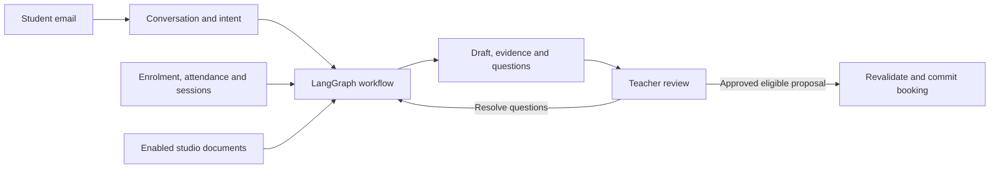

# Ballet Studio AI Copilot

A human-reviewed AI assistant for the administrative work behind a ballet studio: understanding student emails, finding relevant studio information, and preparing responses and makeup-class proposals for a teacher to review.

This is an independent portfolio project built with **Python, FastAPI, LangGraph, PostgreSQL/pgvector, React, and TypeScript**. Students, messages, and studio documents in the demo are fictional. It is not a claim of real studio adoption or time saved.

## The problem

A short email such as “I missed my class. Can I make it up next week?” can require a teacher to check enrolment, attendance, notice, class level, session capacity, and scheduling conflicts before replying. Other emails need answers grounded in studio documents, or a person’s judgment when the information is missing. The project explores how an AI workflow can make that work easier while keeping consequential decisions under human control.

## Try the project

- **Public demo:** Run locally at [http://127.0.0.1:8000/demo](http://127.0.0.1:8000/demo) after following [local setup](#local-setup). Explore the Review Queue, Email Walkthrough, timetable, fictional records, and Studio Knowledge.
- **API:** Open [interactive API documentation](http://127.0.0.1:8000/docs) after starting the app. The [email intake example](#test-an-email-through-one-api-call) shows how to submit a message.
- **How it works:** See the [public demo guide](docs/22-public-live-demo.md), [agent walkthrough](docs/08-agent-api.md), and [architecture notes](docs/04-architecture.md).

Live AI drafting requires an OpenAI API key and incurs API usage charges. The public demo uses fictional data and simulated approvals; it does not send emails or modify the owner’s records. A verified fictional trial request may be automatically approved in the Email Walkthrough; owner-workspace decisions still require teacher review.

## What it does

- **Processes email conversations.** Routes makeup requests, information enquiries, and requests requiring teacher handoff. Threaded intake supplies conversation history for follow-up messages.
- **Checks makeup eligibility.** Uses enrolment, absence and notice, recorded attendance, level order, rosters, and conflicts to identify a specific eligible session. Missing or uncertain information goes to staff review.
- **Supports teacher review.** Shows the draft, evidence, and unresolved questions. A teacher can answer questions, revise the draft, or defer a decision. When an eligible booking is proposed, approval revalidates it and commits the booking atomically; approval does not send an email.
- **Answers from studio documents.** The owner can manage versioned documents, explicitly prepare and enable revisions, and use an opt-in retrieval path to generate cited answers for review. The public demo instead uses a fixed catalog of selected fictional evidence; it does not search or embed the entire public library.
- **Makes the workflow inspectable.** The interface exposes fictional student records, sessions, review decisions, and supporting evidence; LangGraph checkpoints preserve workflow state for review and recovery.

## How it is built



The model interprets messages and drafts responses; application code checks business rules and controls state changes. PostgreSQL stores application data and workflow checkpoints, while pgvector supports document retrieval. The React/TypeScript frontend presents the review workflow, and FastAPI exposes the application API. The public demo uses its own SQLite ledger and fictional records. See the [architecture](docs/04-architecture.md) and [online document answers](docs/20-online-document-answers.md) for details.

## Evaluation and limitations

The repository includes automated tests with scripted model responses, retrieval and RAG evaluations, and optional live-model workflow scenarios. These measure different aspects of the system; passing deterministic tests does not prove the quality of a live model’s response.

A [November 2026 simulated-use evaluation](docs/measurements/whole-agent-portfolio-evaluation-2026-11-16.md) ran 100 everyday and 25 high-risk fictional scenarios. An independent AI reviewer recorded **69/100** and **12/25** passes respectively; 19 everyday and 10 high-risk cases were unscorable because of fixture or expectation limitations. The report also documents substantive failures and notes that later changes were not freshly validated by that run. Teacher adjudication remains pending, so these results do not establish pilot readiness or real-world performance.

The system does not send email or implement financial rules and credit ledgers. Model-generated drafts can be incomplete or incorrect and require review. The public demo is a constrained simulation, not a production deployment for real student data.

## AWS deployment

The complete application can be packaged for a single EC2 host while retaining its
PostgreSQL/pgvector and LangGraph persistence. See the [EC2 deployment guide](docs/23-ec2-deployment.md)
for Terraform, private configuration, HTTPS, releases and backup verification. The Aurora
Data API work remains an isolated feasibility experiment.

## Local setup

In Codex, use `$run-dance-studio-app` to start the local app with the portal origin matched to the configured Google callback.

Start Docker Desktop first. From this project directory:

```sh
docker compose up -d --wait db
cd backend
uv sync --frozen
uv run --env-file .env.example alembic upgrade head
uv run --env-file .env.example alembic check
```

The Compose database is available only on localhost, on port 5433 by default. Its fixed credentials are for this local synthetic demo only. Set `POSTGRES_PORT` for Compose and adjust connection URLs together if that port is occupied. Named Docker storage preserves data when the container stops. `docker compose stop db` stops the database without removing its data.

`.env.example` contains working local development URLs. To customize them, copy it to an ignored `.env` and use `--env-file .env`. Configuration comes from `DATABASE_URL`; models never create or alter tables automatically. The project uses native Python 3.12, selected by `backend/.python-version`, with dependencies pinned in `backend/uv.lock`.

## Run the real app

After local setup, start the actual application server from `backend/`:

```sh
uv run --env-file .env uvicorn studio_copilot.api.app:app --host 127.0.0.1 --port 8000
```

This command assumes you have created `.env` as described above. If you are using only the example configuration, replace `--env-file .env` with `--env-file .env.example`. AI draft generation also requires the agent setup below and configured `OPENAI_API_KEY` and `OPENAI_MODEL`; it uses the real model and incurs API usage charges.

Build the frontend from `frontend/` with a supported Node.js version using `npm ci` and `npm run build`. Leave the server running and open [the public demo](http://127.0.0.1:8000/demo) or [interactive API documentation](http://127.0.0.1:8000/docs). Use **Authorize** with your `ADMIN_API_TOKEN` (the example configuration uses `local-demo-admin-token`). The staff API requires that bearer token or an authorized owner session for its permitted operations; [health](http://127.0.0.1:8000/health) and documentation are public. A healthy database connection returns `{"status":"ok"}`. This is one local staff credential, not a user-account or role-management system.

On subsequent launches, start Docker Desktop, run `docker compose up -d --wait db` from the project directory, and run the server command above from `backend/`. Stop the server with Ctrl+C.

## Test an email through one API call

After agent setup and starting the server, open [Swagger](http://127.0.0.1:8000/docs), authorize with your admin token, and use **POST `/api/v1/incoming-emails`**. For a standalone email, supply the sender and email content:

```json
{
  "from": "new.enquirer@example.com",
  "body": "I have never done ballet. Which class would suit me?"
}
```

To group replies, send the same optional `thread_id` on every intake request. An optional `subject` labels the thread. The server reads the full student email history for that thread. Requests without a thread ID reuse the sender’s latest unthreaded conversation or create one. An unknown sender gets a minimal `New enquirer` profile with no level or enrolments, and their first email uses the same action-based routing as existing students. Later emails reuse their history.

For a known student, send the same two fields with their registered email address, for example `alex@example.com`. Check `status` for `awaiting_review` and read `draft_details.body`, `interpretation` and `evidence`. HTTP 200 can also contain a `failed` run: inspect `error` and retry that run using `/api/v1/agent-runs/{id}/retry`. Review, edit or approve using the existing run review endpoint. Approval stores a response and, when a validated booking proposal is present, adds the student to that session. It does not send email.

No conversation, message or run IDs are needed as input. Each POST is a new email, even if its content repeats. A busy student returns 409 without saving the submission. Model configuration or policy errors return 503 before records are created.

Retrying a failed run uses its ID rather than submitting the email again. Future-dated existing messages still prevent earlier incoming emails from superseding them.

## Optional: load sample data

To populate an empty database for a walkthrough, run this once from `backend/` using the same environment file as the server:

```sh
uv run --env-file .env python -m studio_copilot.demo
```

`demo.py` only inserts fictional students, classes, enrolments, and conversation messages into the database. It does not start a server or run a separate demo application. The real app uses these records when you inspect them or start an AI run through the API. You can instead create records through the administration API.

The fictional Merri Ballet demo uses Brunswick and Carlton rooms, adult Level 2 ballet classes, and Term 1 · Summer 2027. Names and addresses are invented; student emails use the reserved `example.com` domain. Existing seeded records keep their original values because rerunning the seed never overwrites staff edits. If an earlier demo seed used `alex@example.test` or `sam@example.test`, update those student emails through the administration API to `alex@example.com` and `sam@example.com` before using email intake; `.test` addresses are rejected by the intake validator.

The seed command prints useful IDs. It creates fictional February–March 2027 data once and preserves edits on subsequent runs. `"created": false` means the demo records already exist and were left untouched; it is not an error. You do not need to rerun it when starting the app. Use `on_date=2027-02-08` when inspecting the seeded student's current-enrolment view; the normal default is today's Melbourne date. Seeded drafts and context are predefined examples, not AI-generated results.

See the [API guide and walkthrough](docs/07-api.md) for endpoints, filters, enrolment operations, and current limitations.

## Agent setup

After applying the application migration, provision LangGraph checkpoints from `backend/`:

```sh
uv run --env-file .env.example python -m studio_copilot.agent.persistence.checkpoints
```

Set `OPENAI_API_KEY` and `OPENAI_MODEL` in an ignored `.env` or your shell, then start the server using that environment. Studio policy is editable in `backend/policies/studio.yaml`. See the [agent API walkthrough](docs/08-agent-api.md) for starting runs, teacher review, memory updates, retries, and optional live evaluation. The normal test suite uses a fake model and makes no OpenAI requests.

The checkpoint setup command prepares database tables that save workflow progress for teacher review and recovery. “LangGraph checkpoint tables are ready” confirms that setup completed; it does not start the app or generate a draft. Use the same environment file for checkpoint setup and the server so they connect to the same database.

## Verification

Create the separate test database once, from the project directory:

```sh
docker compose exec db createdb -U copilot studio_copilot_test
```

Then, from `backend/`:

```sh
uv run python -m studio_copilot.documents.chunking --prepare-tokenizer
uv run --env-file .env.example pytest
uv run ruff check .
uv run ruff format --check .
```

The default `uv sync --frozen` installs the development group, including the AWS
validation test dependencies (`boto3`/`botocore`). No extra AWS group flag is needed
for the documented test commands; these tests use mocked AWS clients.

Tests are grouped by execution requirements and behavior:

- `backend/tests/unit/`: enrolment rules and the OpenAI SDK adapter with mocked HTTP; no database or live OpenAI calls.
- `backend/tests/integration/persistence/`: fresh schema/model parity, database constraints, enrolment history, and student memory.
- `backend/tests/integration/api/`: students, enrolments, timetable, conversations, validation, access, and demo seeding.
- `backend/tests/integration/agent/`: routing, review, memory, recovery, access, policy, tools, and tool limits, using scripted model responses.
- `backend/evaluations/`: optional paid email-drafting evaluations, outside normal pytest discovery.
- `backend/workflow_evaluations/`: optional paid scenarios covering attendance, booking proposals, teacher review, and idempotency.

Run an individual group from `backend/`, for example:

```sh
uv run pytest tests/unit
uv run --env-file .env.example pytest tests/integration/agent
```

Integration tests require `TEST_DATABASE_URL` with a database name ending in `_test`. Each test creates and removes its own temporary schema there. Without that variable, PostgreSQL tests are explicitly skipped. The schema check verifies that a fresh installation matches the models. Fake-model tests do not establish live model understanding or booking reliability.

Alembic upgrades the consolidated initial schema through the independent-session roster and attendance migrations. The roster migration snapshots historical participants and has no automatic downgrade because that would lose data. LangGraph checkpoint setup remains separate.

### Multi-turn email evaluations

The workflow suite covers consecutive makeup corrections, withdrawal of an
absence after a correction, interleaved threads from the same sender, and a date
change after teacher approval. It checks which messages reach the model,
whether stale drafts can be approved, and what changes in the booking records.

Run the three transition cases from `backend/` using synthetic fixtures in the
configured PostgreSQL test database:

```sh
uv run --env-file .env python -m workflow_evaluations.evaluate --live \
  --case withdraw_absence_after_correction \
  --case interleaved_threads_keep_context \
  --case reschedule_after_approval
```

Live runs call the configured model and incur usage costs. The JSON report
includes structured checks and draft text for manual review. See the
[workflow evaluation guide](backend/workflow_evaluations/README.md) for the
scenario format and test database requirements.

## Design documents

- [PRD and configurable policies](docs/01-prd.md)
- [Domain, database schema, and ER diagram](docs/02-domain-and-schema.md)
- [Draft-and-review workflow](docs/03-makeup-workflow.md)
- [Architecture and repository](docs/04-architecture.md)
- [Incremental backlog](docs/05-backlog.md)
- [Accepted direction and open decisions](docs/06-decisions.md)
- [Administration API guide](docs/07-api.md)
- [Agent setup, APIs, and evaluation](docs/08-agent-api.md)
- [Website and owner workspace](docs/09-website.md)
- [Isolated Aurora Data API feasibility validation](docs/22-aurora-data-api-validation.md)
- [Document ingestion and revision APIs](docs/10-document-ingestion.md)
- [Document RAG design and roadmap](docs/11-rag-design.md)
- [Revision-pinned embedding CLI and recovery](docs/13-document-embeddings.md)
- [Retrieval CLI, source references, and paired keyword/vector/hybrid evaluation](docs/14-document-retrieval.md)
- [Offline local reranking and measured adoption gates](docs/15-document-reranking.md)
- [Consolidated tests, benchmarks, and real model evaluations](docs/16-testing-and-evaluations.md)
- [Offline generation, exact citations and optional verification](docs/17-document-generation.md)
- [Production foundations: ACL, query cache, task budgets and private telemetry](docs/18-production-controls.md)
- [Online document answers and source activation](docs/20-online-document-answers.md)
- [Integrated RAG quality evaluation](docs/21-integrated-rag-evaluation.md)
- [Whole-agent simulated-use evaluation and results](docs/measurements/whole-agent-portfolio-evaluation-2026-11-16.md)
- [Tracing and observability](docs/19-tracing-and-observability.md)
- [Offline chunking and inspection CLI](docs/12-document-chunking.md)

Policies remain external resources. Financial rules, credit ledgers, and email delivery remain outside the implemented workflow.
