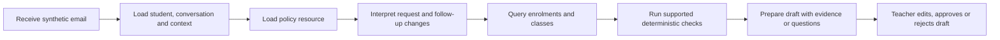

# Makeup enquiry: draft-and-review workflow

This describes the next workflow, not implemented behavior. The earlier booking/confirmation state machine is deferred.

Use a single LangGraph flow. Store messages and student context in PostgreSQL; introduce graph checkpoint persistence when implementing the graph rather than designing its internal tables ourselves.

A follow-up within the same conversation updates the existing discussion. Load student context across conversations, but ask for clarification when the referenced request is unclear. Keep student-stated experience distinct from verified highest level. Memory records should cite source messages when the memory updater is implemented.

Example: a student requests Thursday, then writes “Actually, Saturday instead.” The next interpretation uses the Saturday preference and preserves the earlier message as history. A previous assistant draft is available as a draft, never represented as something the student received.

The teacher reviews suggested information and a response, not executable booking commands. Approval saves a review outcome only. No absence is recorded, entitlement issued, seat reserved, enrolment changed, or message sent. Unknown policy and unclear suitability are shown for teacher judgment.

Initial acceptance scenarios: ordinary request, consecutive-email preference change, missing details, supported policy change, and teacher-edited draft. Booking concurrency, expiring offers, financial exceptions, and worker-failure recovery belong to later workflows.
