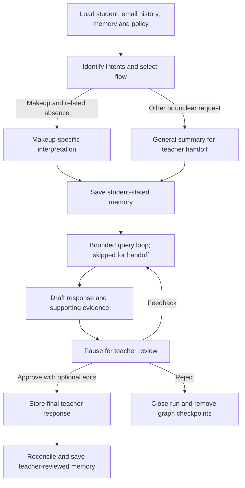

# Makeup enquiry: implemented agent workflow

The local backend now runs one LangGraph graph with the OpenAI Responses API. It accepts stored synthetic emails for known students; teachers review drafts through the staff API. It has no booking or email delivery tools.

## Routing before interpretation

A separate structured `Routing` model identifies current intents before extracting flow-specific details. It uses the latest email, conversation history, and student memory so a short follow-up can remain in its existing discussion. The model reports intent labels, a request summary, whether the intent itself needs clarification, and a routing reason.

Supported labels are `makeup`, `absence`, `enrolment`, `cancellation`, `new_student_enquiry`, `general_enquiry`, and `unknown`. Only makeup (optionally combined with its absence) has an implemented detailed flow. Python selects that branch only when the intents are clear and all belong to that combination. Independent mixed requests, unsupported flows, and ambiguous cancellation requests go to teacher handoff rather than silently dropping part of the request.

`MakeupInterpretation` contains makeup-specific dates and location preferences. `RequestInterpretation` contains the common summary/memory fields; future flows can define their own detail models. The handoff path uses a general summary, skips makeup interpretation and tools, and prepares an acknowledgement or clarification draft for teacher handling. Memory and approval remain shared. A routing-model failure also creates a neutral handoff.

Routing is visible in `AgentRun.interpretation.routing`, with the selected branch in `interpretation.flow`. Adding a later flow requires its detail model, interpreter, tools and graph branch; identifying a label does not implement that workflow. New-student intake still requires a stored student and conversation in this version.

## Memory and review

The first memory update happens immediately after interpretation, before querying. Follow-up emails such as “Actually, Saturday instead” replace the current conversation's interpretation without becoming lasting preferences. Original emails remain immutable history.

The second update happens after approval. The final edited teacher response is stored as a distinct `teacher_response` message, linked to its run and draft. The model reconciles the conversation summary with that response. A failed reconciliation can be retried without creating another response, even after a newer student email arrives. Earlier approved outcomes remain source-linked in memory; recovering them preserves newer request summaries and preferences.

`Student.ai_summary` is a readable rendering of source-linked structured memory in `context._agent_memory`. Student statements and teacher-reviewed information are labelled separately. Other context keys survive automatic updates. Staff PATCH of the whole context still replaces it; clients should preserve `_agent_memory` unless deliberately correcting it. Memory cannot change highest level or enrolments.

Teacher-approved response content is not evidence of sending, student acceptance, or a completed booking. No send operation exists. Rejection stores no reason, rejection event, or conversation message; the run becomes neutrally `closed`, its draft remains as an unsent draft, and its checkpoints are deleted. Student-stated memory remains.

## Bounds and policies

Each drafting attempt permits four model/tool rounds, with at most three tool executions per round. Identical calls after argument normalization are blocked. Missing essential details, empty results, invalid calls, query failures, and exhausted limits stop gathering. Drafting then shows uncertainty or asks for clarification; if drafting itself fails, a conservative clarification template is used. Only explicit teacher feedback starts another attempt.

Tools read the current student's enrolments, timetable sessions, locations, and notice timing. They cannot query another student's messages or accept a replacement student ID. Session candidates are not guaranteed makeup seats or placement approval. Database tool queries have a five-second statement timeout. OpenAI requests have a 20-second SDK timeout and one transient-error retry.

`backend/policies/studio.yaml` contains supported settings and explanatory text. A run retains its policy snapshot, including across revisions. Policy edits affect new runs. Unknown settings and malformed files are rejected visibly; unsupported rule types require implementation. There is no invented credit limit or makeup entitlement.

## Persistence and concurrency

Application records use Alembic; LangGraph manages its checkpoint tables through an explicit setup command. PostgreSQL checkpoints preserve review pauses across service restarts. Each source email has at most one run. Newer student emails supersede pending drafts according to occurrence time, creation time, and ID. Old draft revisions cannot be approved.

A student-scoped PostgreSQL advisory lock serializes processing and message insertion. Conflicting requests receive 409 and may be retried; the API does not wait indefinitely for that lock. This local synchronous runtime intentionally has no worker queue. See [agent API and walkthrough](08-agent-api.md).
