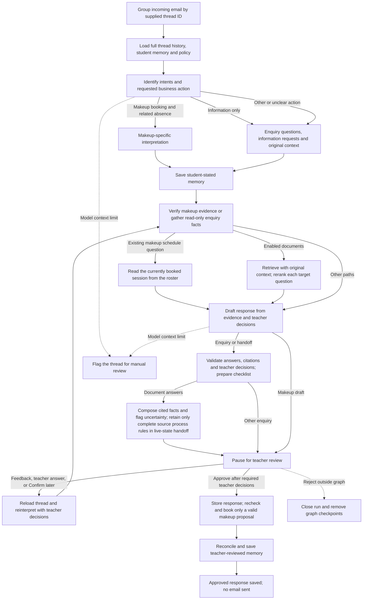

# Email enquiry and makeup workflow

The local backend runs one LangGraph graph with the OpenAI Responses API for new and existing students. Teachers review drafts through the staff API. Query tools are read-only; a verified makeup proposal can be booked only on teacher approval. The system has no email delivery tool.

This diagram shows the user-facing workflow, including teacher review actions outside the graph. The question statuses and draft checks describe work within nodes; they are not separate graph nodes.

For `needs_student`, the draft asks the student for clarification; no separate teacher answer is required for that question. For `needs_teacher`, the teacher supplies an answer or explicitly chooses **Confirm later**, then updates the draft before approval. Each supplied answer returns to drafting with its original question. Draft validation checks the answer checklist and evidence references before teacher review. Confirming later does not create a reminder or send a follow-up. A later student email starts a new run using the conversation history.

## Routing before interpretation

A separate structured `Routing` model identifies current intents before extracting flow-specific details. It uses the latest email, conversation history, and student memory so a short follow-up can remain in its existing discussion. The model reports intent labels, a request summary, whether the intent itself needs clarification, and a routing reason.

Supported labels are `makeup`, `absence`, `enrolment`, `cancellation`, `new_student_enquiry`, `general_enquiry`, and `unknown`. Labels describe the topic; `routing.action` selects the workflow:

- `information_only` → `enquiry`, including informational makeup options and cancellation/enrolment policy questions.
- `makeup_booking` → `makeup` only when the intents contain makeup and optionally its related absence.
- `other_action` or `unclear`, including unsupported or independent mixed requests → `teacher_handoff`.

New and existing senders use the same router. Intake still creates a minimal profile for an unknown sender. Saving emails, drafts and memory is not a business action. A routing failure produces a neutral handoff.

`MakeupInterpretation` contains booking-specific dates and preferences. `EnquiryInterpretation` extends the shared summary/memory fields with individual questions and requested actions; both enquiry and handoff use it. Each draft records `answers` with the exact question, `answered`/`needs_student`/`needs_teacher` status, proposed response and evidence references. Missing, duplicate or unsupported answers become teacher tasks; unsupported factual claims trigger a conservative draft rebuild. Citation validation checks identifiers, not semantic correctness, so teacher review remains required.

For information-only routes, explanation and comparison requests extracted as actions join the question checklist even when other questions exist. If extraction yields no question, the original request becomes the question. Retrieval uses the original request to disambiguate split subquestions; the bounded reranker receives only the target question, which generation answers. A follow-up about a confirmed makeup schedule can use current roster evidence. Other live-status enquiries can retain a complete, cited general process rule while leaving the personal outcome for teacher review.

Enquiry tool dispatch allows only timetable, session and location lookups. Student emails, teacher-approved replies and confirmed roster entries can be cited as context evidence; student statements do not establish studio policy or completed actions. Revision feedback is retained with the draft evidence across successive reviews; the latest correction supersedes conflicting earlier feedback. Information-only makeup results cannot establish eligibility or reserve a place. Human handoff may gather bounded read-only facts but cannot execute actions. Only makeup approval can book a validated replacement. Revisions refresh enquiry interpretation and evidence; teacher-supplied facts may use the `teacher_feedback` reference when feedback exists. Old graph nodes and missing metadata remain compatible with pending reviews.

## Memory and review

The first memory update happens immediately after interpretation, before querying. Follow-up emails such as “Actually, Saturday instead” replace the current conversation's interpretation without becoming lasting preferences. Original emails remain immutable history.

The second update happens after approval. The final edited teacher response is stored as a distinct `teacher_response` message, linked to its run and draft. The model reconciles the conversation summary with that response. A failed reconciliation can be retried without creating another response, even after a newer student email arrives. Earlier approved outcomes remain source-linked in memory; recovering them preserves newer request summaries and preferences.

`Student.ai_summary` is a readable rendering of source-linked structured memory in `context._agent_memory`. Student statements and teacher-reviewed information are labelled separately. Other context keys survive automatic updates. Staff PATCH of the whole context still replaces it; clients should preserve `_agent_memory` unless deliberately correcting it. Memory cannot change highest level or enrolments.

Teacher approval stores the final response and atomically books a validated session when the draft includes a proposal. It does not send the response or establish student acceptance. No send operation exists. Rejection stores no reason, rejection event, or conversation message; the run becomes neutrally `closed`, its draft remains as an unsent draft, and its checkpoints are deleted. Student-stated memory remains.

## Bounds and policies

For enquiries and non-makeup handoffs, each drafting attempt permits four model/tool rounds, with at most three tool executions per round. Makeup verification and candidate checks run in a fixed sequence. Identical calls after argument normalization are blocked. Missing essential details, empty results, invalid calls, query failures, and exhausted limits stop gathering. Drafting then shows uncertainty or asks for clarification; if drafting itself fails, a conservative clarification template is used. A teacher revision with feedback or question decisions starts another attempt.

Tools read the current student's enrolments, timetable sessions, locations, and notice timing. They cannot query another student's messages or accept a replacement student ID. Session candidates are not guaranteed makeup seats or placement approval. Database tool queries have a five-second statement timeout. OpenAI requests have a 20-second SDK timeout and one transient-error retry.

`backend/policies/studio.yaml` contains supported settings and explanatory text. A run retains its policy snapshot, including across revisions. Policy edits affect new runs. Unknown settings and malformed files are rejected visibly; unsupported rule types require implementation. There is no invented credit limit or makeup entitlement.

## Persistence and concurrency

Application records use Alembic; LangGraph manages its checkpoint tables through an explicit setup command. PostgreSQL checkpoints preserve review pauses across service restarts. Each source email has at most one run. Newer student emails supersede pending drafts according to occurrence time, creation time, and ID. Old draft revisions cannot be approved.

A student-scoped PostgreSQL advisory lock serializes processing and message insertion. Conflicting requests receive 409 and may be retried; the API does not wait indefinitely for that lock. This local synchronous runtime intentionally has no worker queue. See [agent API and walkthrough](08-agent-api.md).

Intake uses the supplied thread ID to keep the sender's separate email threads apart. A run loads
all student emails in that conversation through its source email in chronological order. It loads
teacher replies separately with unconfirmed delivery status. Staff-entered final replies are also
included. Internal drafts and staff notes stay
out of the transcript. When the model cannot fit the full thread, the run is flagged for manual
review.

Before every OpenAI request, a local pseudonymization layer replaces the known student's name,
name components, email and ID with placeholders. It also masks email addresses in nested memory,
feedback, history and tool results. The mapping stays local and restores model outputs for teacher
review. This targets known student identity and email addresses; it does not detect every possible
identifier, such as phone numbers, postal addresses or unknown third-party names. Provider-generated
encrypted reasoning tokens remain unchanged for replay; their readable summaries are redacted.

## Attendance and makeup safety

The dated roster identifies who is assigned, not who actually attended. Staff record attendance separately; unknown attendance for a completed missed session requires review. The model identifies the claimed absence and any specifically named replacement class; code verifies the matched session, enrolment, notice provenance, and attendance. When the configured policy requires notice before the session, late notice is escalated to the teacher without a booking proposal. Candidates are filtered by configured level order, the student's highest recorded attended level, membership, overlap, capacity, and any explicitly extracted class name. Named-class extraction remains a model interpretation, so teachers must review the evidence and draft.

An original absence notice can support multiple clear makeup date changes. Conflicting or unfamiliar intervening replies require staff review. A proposed booking is rechecked in the approval transaction, including attendance, level, roster, overlap, capacity, session details, and whether that student already has a confirmed makeup for the missed session. Availability is not reserved before approval. A question asking for options does not itself create a proposal.
