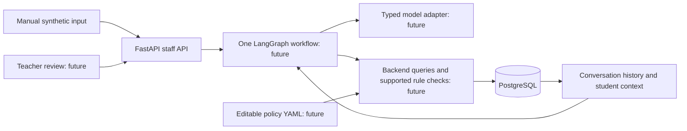

# Architecture and repository

## Current backend

A small Python package using FastAPI, PostgreSQL, SQLAlchemy, and Alembic. It stores studio records, enrolment history, messages, and student context. Staff can manage those records through a local bearer-protected API. No agent, worker, or dashboard exists yet.

```text
dance-studio-agent/
  backend/
    pyproject.toml
    uv.lock
    alembic.ini
    migrations/
    src/studio_copilot/persistence/
      models.py
      database.py
    src/studio_copilot/administration/
      service.py
    src/studio_copilot/api/
      app.py
      schemas.py
      students.py
      timetable.py
      enrolments.py
      conversations.py
    src/studio_copilot/demo.py
    tests/
  compose.yaml
  docs/
```

The local PostgreSQL 18 container has persistent storage and binds to localhost. Configuration uses `DATABASE_URL`, with separate `TEST_DATABASE_URL` for test schemas and `ADMIN_API_TOKEN` for staff access. Commands and local credentials are documented in the root README. No production deployment is configured.

HTTP schemas validate requests; synchronous routes use one SQLAlchemy session per request. Ordinary application services implement enrolment changes and timetable checks without importing FastAPI. Each write commits once; a failed class transfer rolls back both attendance periods. Regular enrolment/session writers coordinate with a class-row lock while checking capacity of existing dated sessions. This does not implement makeup inventory or a queue system.

## Next architectural layer



The agent interprets and drafts. Backend services query official enrolments and evaluate supported policy settings. PostgreSQL stores conversation memory; no vector store is necessary to resume a known student's discussion. Mutable studio policies remain external inputs, without a general rules engine.

Keep this as one codebase. Add modules as their behavior is implemented rather than generating empty application layers. LangGraph, checkpoint persistence, policy loading, and context summarization are next steps. SQS, job leases, outbox delivery, RAG, detailed makeup booking transactions, React, and AWS are deferred.

The current staff API uses one configured local bearer credential. User accounts, staff roles, and per-actor audit records are deferred. A future AI integration must keep model memory updates limited to conversational context and use approved application operations for official data.
