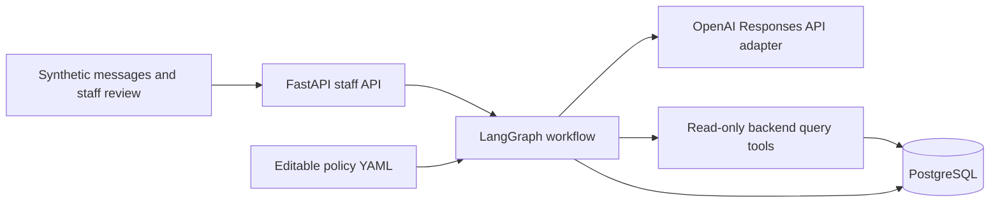

# Architecture and repository

## Runtime

One Python codebase uses FastAPI, PostgreSQL, SQLAlchemy, Alembic, LangGraph, and the OpenAI Python SDK. The staff API handles ordinary administration; the graph handles a teacher-reviewed makeup enquiry. There is no worker queue, browser UI, real inbox, or email delivery.

A structured intent-routing step precedes flow-specific interpretation. The makeup branch uses `MakeupInterpretation`; other or unclear requests use a teacher-handoff branch with no makeup queries. Shared memory, drafting, and review follow the selected interpretation. Enrolment, cancellation, and new-student flows can be added as separate branches later.

The agent package keeps responsibilities separate:

- `workflow/graph.py` defines graph nodes, edges, and tracing.
- `workflow/nodes.py` implements each step's model decisions and state updates.
- `workflow/queries.py` runs bounded, read-only tool exploration.
- `persistence/store.py` owns short database transactions for context, memory, drafts, and approval.

Shared contracts, `openai_model.py`, policy loading, query tools, and run lifecycle services stay at the package root. Agent-specific database transactions, checkpoints, and locking are grouped under `persistence/`. See the [package map](../backend/src/studio_copilot/agent/README.md) for the full layout and reading order. HTTP routes stay separate from graph behavior. Future model integrations can implement the same small adapter contract; tests use a deterministic fake.

## Two kinds of persistence

Application tables store official studio records, messages, run results, and student memory. Alembic manages these nine tables. `AgentRun` connects a source email to its interpretation, policy snapshot, evidence, current draft, revision, and approved response.

LangGraph's PostgreSQL saver manages checkpoint tables separately. Each run's UUID is its graph thread ID. Framework setup is explicit; startup performs no automatic migration. Review interrupts survive restarts. Conversation continuity comes from application messages and student memory, rather than reusing one student's entire graph state indefinitely.

The first memory update follows interpretation and precedes queries. The second follows storage of the final teacher response. Structured source-linked memory occupies `Student.context._agent_memory`, while `ai_summary` renders it for staff inspection. Other context keys are preserved. Official highest level and enrolments remain staff-managed.

## Execution boundaries

Model-selected tools are read-only, student-scoped, validated, and bounded to four rounds and three calls per round. Unsupported policy or missing data becomes visible uncertainty. No graph node executes bookings, financial changes, or message delivery.

A session-level advisory lock serializes agent work per student. Incoming messages use the matching transaction lock and return a conflict if processing is active. Database row locks are limited to short persistence transactions rather than model calls. Identical source starts and approval retries reuse existing records; edited draft revisions require a matching version.

The existing enrolment service retains its transaction and regular-roster capacity checks. Those checks do not establish makeup inventory. The existing local admin bearer token protects both administration and agent endpoints; user accounts and role management remain deferred.

## Operation

Use the local PostgreSQL 18 Compose service with a dedicated `_test` database for integration tests. Configure `OPENAI_API_KEY`, `OPENAI_MODEL`, and optional policy path through the environment. Structured local logs report graph/tool activity and model usage. See the [agent walkthrough](08-agent-api.md) for setup, errors, retries, and evaluation.
