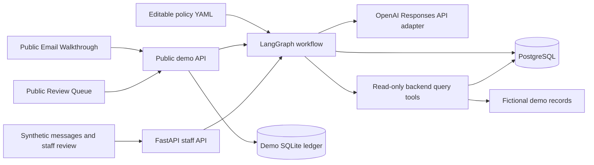

# Architecture and repository

## Runtime

One Python codebase uses FastAPI, PostgreSQL, SQLAlchemy, Alembic, LangGraph, and the OpenAI Python SDK. The staff API handles ordinary administration; the graph handles teacher-reviewed enquiries, makeup requests, and handoffs. The React website serves a public Review Queue, an Email Walkthrough, and a Google-authenticated owner workspace from the same FastAPI origin. Both use the same graph. Public runs read the fictional records published in Database and Timetable and store checkpoints and simulated approvals in a separate SQLite ledger. Owner runs use the authenticated API and PostgreSQL. There is no worker queue, real inbox, or email delivery.

Structured routing separates intent labels from the requested business action. Information-only requests use an enquiry branch; supported makeup bookings use the deterministic makeup branch; other or unclear actions use teacher handoff. Both new and existing senders follow this rule. `EnquiryInterpretation` tracks questions and requested human actions, while `MakeupInterpretation` retains booking details. Memory, drafting and review are shared. Enquiry/handoff approval saves the reply; only makeup can execute a booking.

The agent package keeps responsibilities separate:

- `workflow/graph.py` defines graph nodes, edges, and tracing.
- `workflow/nodes.py` implements each step's model decisions and state updates.
- `workflow/queries.py` runs bounded, read-only tool exploration.
- `persistence/store.py` owns short database transactions for context, memory, drafts, and approval.

Shared contracts, `openai_model.py`, policy loading, query tools, and run lifecycle services stay at the package root. Agent-specific database transactions, checkpoints, and locking are grouped under `persistence/`. See the [package map](../backend/src/studio_copilot/agent/README.md) for the full layout and reading order. HTTP routes stay separate from graph behavior. Future model integrations can implement the same small adapter contract; tests use a deterministic fake.

## Two kinds of persistence

Application tables store official studio records, messages, run results, and student memory. Alembic manages nine application tables. Each class session owns its independent student UUID list; names resolve from student profiles. `AgentRun` connects a source email to its interpretation, policy snapshot, evidence, current draft, revision, and approved response.

LangGraph's PostgreSQL saver manages checkpoint tables separately. Each run's UUID is its graph thread ID. Framework setup is explicit; startup performs no automatic migration. Review interrupts survive restarts. Conversation continuity comes from application messages and student memory, rather than reusing one student's entire graph state indefinitely.

The first memory update follows interpretation and precedes queries. The second follows storage of the final teacher response. Structured source-linked memory occupies `Student.context._agent_memory`, while `ai_summary` renders it for staff inspection. Other context keys are preserved. Official highest level and enrolments remain staff-managed.

## Execution boundaries

Model-selected tools are read-only, student-scoped, validated, and bounded to four rounds and three calls per round. Unsupported policy or missing data becomes visible uncertainty. Model tools never write. Explicit teacher approval can reserve an evidenced session and save the reviewed reply atomically. No financial changes or message delivery occur.

A session-level advisory lock serializes agent work per student. Incoming messages use the matching transaction lock and return a conflict if processing is active. Database row locks are limited to short persistence transactions rather than model calls. Identical source starts and approval retries reuse existing records; edited draft revisions require a matching version.

The existing enrolment service retains its transaction and regular-roster capacity checks. Capacity checks now count distinct regular attendees and approved session bookings. The existing local admin bearer token protects administration clients. Google owner sessions grant read access and explicit agent actions with CSRF protection; they cannot directly write studio records. Public fixtures are separate from workspace data. See [website setup](09-website.md).

## Operation

Use the local PostgreSQL 18 Compose service with a dedicated `_test` database for integration tests. Configure `OPENAI_API_KEY`, `OPENAI_MODEL`, and optional policy path through the environment. Structured local logs report graph/tool activity and model usage. See the [agent walkthrough](08-agent-api.md) for setup, errors, retries, and evaluation.
