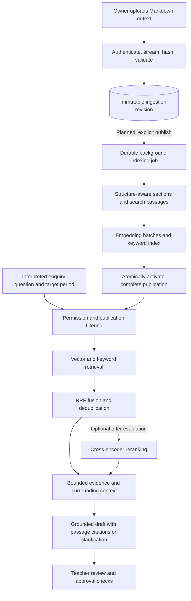

# Document RAG design and roadmap

## Status and scope

This document records the agreed design for document-based retrieval-augmented generation (RAG). **Ingestion, offline chunking, PostgreSQL embedding preparation, and explicit CLI retrieval inspection are implemented.** Chunking exports local inspection files; embedding reads an explicit immutable revision and saves chunks/vectors in PostgreSQL. Documents are not yet published or supplied to the agent. CLI retrieval requires explicit completed embedding runs and a target date. The sections below explicitly distinguish existing behavior from planned work.

The initial scope is English Markdown and plain text, up to **10,000,000 bytes per file**, answering specific questions. Whole-document analysis, PDF/DOCX extraction, OCR, external document synchronization, and multi-tenant access are deferred. The sample studio handbook is an example, not the structure every document must follow or an authoritative policy to load automatically.

The agent continues to prepare replies for teacher review. Live timetable, capacity, enrolment, and attendance facts come from database tools. Makeup eligibility and booking validation remain deterministic code responsibilities. Retrieved text cannot authorize a business action or change those rules.

## Intended data flow

The diagram describes the target system. Upload through immutable ingestion revision exists, together with independently invoked chunking and embedding preparation CLIs. There is no background indexing pipeline yet.

## 1. Data ingestion

**Implemented:** authenticated multipart upload/replacement, UTF-8 validation, bounded requests and files, SHA-256, immutable revisions, effective-date metadata, optimistic concurrency, duplicate notices, and revision-pinned previews. See the [ingestion guide](10-document-ingestion.md) for APIs, limits, migration, and hash provenance.

The upload path streams fragments into one temporary file while incrementally updating the raw-byte SHA-256. After receipt, the bounded file is decoded and validated before a short database write transaction. It is not an end-to-end constant-memory pipeline: up to one supported source file is materialized for validation and storage. PostgreSQL stores the current text and complete revision snapshots; this is not content-addressed storage or storage deduplication across revisions.

Deduplication has two deliberate meanings:

- Saving identical content and metadata on the same document creates no new revision.
- Separate documents with identical current content hashes produce duplicate notices and remain separate documents. Whitespace, newline, and Unicode differences are not normalized away.

An ingestion revision is a saved snapshot, not a publication. Changing a title or effective date also creates a revision. A successful upload proves that the received source is complete enough to validate and save; it does not establish that its contents are complete, current, or approved studio policy. The owner remains responsible for that assessment.

**Planned:** publishing captures a saved revision and queues indexing in PostgreSQL. A worker uses leases, bounded retries, progress reporting, and restart recovery. Completed embedding batches can be reused using a key containing the actual embedding input hash, model, dimensions, and preprocessing version. External synchronization is not part of the first version; owners upload replacements explicitly.

Only a completely indexed revision becomes the active publication. A failed or superseded job must not replace the previous successful publication. Unpublishing or deleting excludes the source from new retrieval immediately. Historical run evidence is retained separately from the document library.

## 2. Chunking

**Implemented offline: structure-aware recursive splitting with parent-child context.** See the [chunking guide](12-document-chunking.md) for CLI setup, provenance, limits, inspection files, and measured large-file behavior. The embedding CLI now reuses this engine and persists its chunks. Automatic invocation, retrieval indexes, and publication remain planned.

| Layer           | Starting size                                               | Purpose                                              |
| --------------- | ----------------------------------------------------------- | ---------------------------------------------------- |
| Search passage  | Target 600 tokens, maximum 900 including its heading prefix | Precise keyword and vector retrieval                 |
| Context section | Maximum 2,400 tokens                                        | Surrounding explanations, conditions, and exceptions |
| Passage overlap | Approximately 80 tokens within the same section             | Preserve continuity across split boundaries          |

Use token counting rather than character-to-token estimates. Parse Markdown headings and block boundaries; group paragraphs when headings are absent or unhelpful. Split oversized content by paragraphs, then sentences, and finally tokens for individual oversized sentences or blocks. The maximum takes precedence over preserving an unusually large block intact.

The offline implementation pins markdown-it-py 4.0.0 and tiktoken 0.12.0 with `cl100k_base`. It measures final rendered text, including context, rather than adding component counts. Generated title/path prefixes and repeated table headers are each capped at 128 tokens, with truncation warnings and full original content retained in primary source spans. Token work windows are capped at 8,192 characters and may underfill a target on token-sparse input.

To avoid millions of parser objects, sources exceeding 100,000 logical lines or 100,000 pipe characters use bounded paragraph/line fallback with an explicit `structure_complexity_fallback` warning. These exports preserve all original text but make no inferred heading/table-context claims. Inspect them before treating them as suitable inputs for future indexing. There is no automated publication path that accepts these results today.

Keep lists, tables, and examples together where they fit. Split large tables between rows and repeat column headers; split oversized individual rows into bounded fragments that retain their headers. Store document identity, revision, heading path, source offsets, parent section, neighbours, and chunker version. Repeated heading text must not serve as the unique passage identity.

Embed the title, heading path, and passage body. Retrieve small passages first, then expand to bounded parent context when the evidence budget permits. Merge overlapping excerpts. The whole file is never used as a parent context to send to the drafting model.

Semantic boundary detection using another model is deferred. These sizes are initial defaults to test against varied documents, not a guarantee that every restriction or cross-reference will appear in one chunk.

## 3. Embedding

**Implemented preparation:** an explicit revision-pinned CLI uses `text-embedding-3-small` with 1,536 dimensions and a PostgreSQL/pgvector shared cache. See the [embedding guide](13-document-embeddings.md) for setup, paid-call boundaries, lease fencing, recovery, and measurements. Explicit CLI search and query embeddings are implemented; online agent retrieval remains planned. The intended retrieval metric is cosine distance. Questions and document passages use the same model configuration. OpenAI embeddings are unit-normalized; the baseline does not manually truncate or renormalize vectors.

Validate response counts, dimensions, and finite numeric values. Record the model, dimensions, input hash, and preprocessing version. Process at most 64 passages per batch, checkpoint completed work, and keep provider calls outside database write transactions. Reuse unchanged embedding inputs, including their title/heading prefixes, rather than assuming an unchanged body always has an unchanged embedding.

Apply the existing known-student identity pseudonymization to query text before embedding. Explicit embedding `run` sends document passages to the configured provider and incurs API usage; it does not publish them. Future publishing must make provider processing clear. Do not describe embedding as local processing.

Changing models requires a separately built compatible index, evaluation, and an explicit switch. Never compare query vectors with an incompatible document-vector configuration.

## 4. Retrieval

**Implemented inspection baseline:** an explicit CLI searches selected completed embedding runs using PostgreSQL full-text search plus exact pgvector cosine search, fused with reciprocal rank fusion (RRF). See the [retrieval guide](14-document-retrieval.md). A frozen-corpus experiment now provides local-only planning, explicitly paid fictional-source preparation, and paired keyword/vector/hybrid comparison with invocation-local question-vector reuse and provenance/failed-case reporting. The first real-provider comparison is recorded below. It adds no reranker, publication, search API/UI, or agent access. The publication-filtered online path below remains planned.

**Measured on 2026-11-07:** real OpenAI embeddings on the frozen fictional handbook achieved held-out Recall@6 of 100% for vector-only and hybrid, versus 27.78% keyword-only (18 answerable questions). Vector-only MRR@6 was 0.9722; hybrid was 0.9444. Both still returned candidates for questions without source answers. See the [live comparison and limitations](14-document-retrieval.md#live-openai-comparison--2026-11-07); these small-fixture results are not a production reliability claim.

**Larger follow-up, same settings:** 16 fictional documents / 201 unique passages / 100 questions, with disjoint policy families between splits and real OpenAI document/question embeddings, achieved held-out Recall@6 of 95% for vector and hybrid (40 answerable questions). MRR@6 was 0.9133 and 0.9258 respectively; all-required evidence coverage was 92.5%, rising to 95% after parent expansion. All held-out evidence appeared in top-20 candidates. Four date exclusions passed; all 16 in-period no-answer questions still returned semantic candidates. This identifies final selection and evidence sufficiency as remaining work without implementing reranking or generation. See the [larger-corpus measurement](14-document-retrieval.md#larger-frozen-corpus-comparison--2026-11-07).

- Filter by permissions, active publication, and effective dates during candidate retrieval. Do not rely on filtering inaccessible results after retrieval or after reading a cache entry.
- Use English full-text search with a GIN index and `ts_rank_cd`; this is **not BM25**. A BM25 extension or separate search service requires its own evidence-backed decision.
- The CLI uses exact vector search. Consider HNSW only after measuring latency and its recall against this baseline, including filtered-search behavior.
- Take up to 20 candidates from each retrieval path, fuse with RRF, deduplicate, and retain up to 40 candidates before final selection. Start with RRF's rank constant set to 60.
- Supply up to six search passages per question. Deduplicated, expanded document evidence shares a 12,000-token budget across the drafting attempt. Cover questions before expanding surrounding sections, and report truncation.

Automatically retrieve for each question in enquiry and teacher-handoff flows. The deterministic makeup-booking flow remains unchanged. Retrieval failures should preserve independently available database evidence; an embedding outage can fall back to keyword-only retrieval with a staff warning.

Interpret an optional question-specific target date or period. Ground relative dates in the source email's local date and named terms in database records. Undated questions default to the source email's local date. Only publications covering the requested period support a definite answer; ambiguous periods need student clarification and missing applicable information needs teacher input.

For the first publication version, one publication per document is active for new searches. A future-dated replacement does not silently preserve an earlier publication for current-date questions: the owner must see that the replacement leaves those questions without an applicable source. Scheduled publication succession is deferred.

## 5. Reranking

**Implemented offline:** local L6/L12 cross-encoder comparison replays frozen hybrid candidates, selects on tuning only, then validates one model on new policy families. The selected L6 improves fresh complete evidence from 36/40 to 38/40 with warm CPU p95 331 ms; it passes the declared experiment gates. Normal search remains unchanged. See the [reranking guide](15-document-reranking.md) and [consolidated test/evaluation summary](16-testing-and-evaluations.md).

**Decision: establish the hybrid baseline before enabling a neural reranker.** RRF combines rankings; it is not a cross-encoder or an LLM reranker.

Keep the initial online path as hybrid retrieval, RRF, and bounded evidence selection. Compare an English cross-encoder offline on the same candidates and held-out questions. Evaluate ranking quality, inference latency, memory, deployment requirements, and input truncation. Choose a particular model only after that comparison. A reranker cannot recover evidence missing from the candidate set.

Do not enable a cross-encoder merely because the file is large. Adopt it only if the held-out improvement and measured resource costs justify it. LLM reranking is not the default because it adds provider calls and latency. The local runtime is an optional dependency group for offline experiments and is not loaded by ingestion or normal search.

## 6. Generation and grounding

**Planned:** pass selected excerpts and their immutable passage references into the existing question-by-question drafting and teacher-review flow.

Each question receives a supported answer, a request for student details, or an explicit need for teacher input. Answers cite evidence actually supplied in that drafting attempt. Retain the title, revision, section, effective dates, source offsets, and exact excerpt in run evidence so document changes cannot rewrite what a teacher reviewed.

Treat documents as evidence, including when their contents contain instructions. They cannot override the system task, access other students' information, change booking eligibility, or authorize enrolments, refunds, or other business actions. Use database tools for live facts. Surface discovered document conflicts or conflicts with business rules for teacher clarification.

Deterministic citation checks establish that a reference exists and was supplied; they do not establish that the text supports the claim. Semantic support is evaluated separately and inspected by the teacher. Similarity and reranker scores are not probabilities that an answer is correct.

Before approval, verify cited publications remain active and applicable. A replaced or retired source requires regeneration. Approval-time source validation and publication changes must coordinate transactionally to avoid a check-then-change race.

## 7. Evaluation

**Planned:** begin with at least 40 manually checked questions, with tuning and held-out subsets. Label expected answers, evidence positions in original sources, and clarification/teacher-handoff outcomes. A small initial set is an acceptance baseline, not proof of general reliability.

| Stage                     | Measures                                                                                             |
| ------------------------- | ---------------------------------------------------------------------------------------------------- |
| Candidate retrieval       | Recall@20 for each individual retrieval path; recall of the fused candidate set                      |
| Final selected evidence   | Recall@6 and MRR@6; expected evidence coverage and first relevant result position                    |
| Approximate vector search | Recall against an exact-search baseline, separately from semantic evidence recall                    |
| Answers                   | Factual correctness, faithfulness, and citation support                                              |
| Abstention                | Correct abstention and false abstention when an answer exists                                        |
| Operations                | Ingestion completeness, recovery, indexing duration, peak memory, p95 query latency, and token usage |

Define evidence relevance using original-source positions or information units, so changing chunk boundaries does not invalidate the labels. For questions requiring multiple passages, measure coverage of all required evidence; finding one relevant passage is insufficient. Evaluate evidence that survives parent expansion and context-budget trimming as well as the pre-trimming search results.

Compare keyword-only, vector-only, hybrid, and optional reranked variants. Faithfulness measures whether claims follow supplied context; a faithful answer can still repeat incorrect or outdated source material. Automated judges can assist, but cannot replace reference answers and human checks of important claims.

The initial target is final evidence Recall@6 of at least 90%, with all defined citation-validity and business-safety cases passing. Include no-answer, conflicting, future/expired, multi-section, and prompt-injection cases. Large-file fixtures must cover repeated or missing headings, long tables and sentences, Unicode, answers near the end, and evidence far apart. Do not tune on the held-out subset.

Ingestion already has deterministic unit, PostgreSQL integration, and desktop/mobile browser coverage. Future embedding and drafting tests use fakes in normal CI; paid live evaluations remain separate and explicitly reported.

## 8. Production controls

**Existing foundation:** single-studio owner/admin authorization, browser origin/CSRF checks, bounded ingestion, version conflict checks, and optional content-restricted tracing for the agent. Ingestion adds no anonymous document access or model calls.

**Planned additions:**

- Apply the same permission boundary to publication, search preview, retrieval, citation inspection, and caches. Multi-tenant isolation requires an explicit future design.
- Reuse passage embeddings by complete embedding-input identity. Bound query-embedding caches. Key retrieval caches by permission scope, publication-set version, target period, and retrieval configuration; invalidate on publication changes. Do not cache final student replies.
- Extend allowlisted logs and optional tracing with ingestion/indexing/retrieval timing, counts, retries, cache hits, degradation, token usage, and generic failures. Do not export document text, student emails, prompts, or full tool results.
- Expose worker heartbeats, job progress, queue age, and indexing failures. Track p95 retrieval latency, context truncation, and teacher-handoff trends without treating all handoffs as failures.
- Bound batch sizes, worker concurrency, retries, candidate counts, and evidence tokens. Show estimated embedding input tokens before publication and retain actual usage. Select cost and latency budgets from measured workloads rather than promising an unmeasured SLA.
- Keep source snapshots, run evidence, and backups under documented retention rules. Removing library content from retrieval is distinct from deleting retained evidence.

## Delivery sequence and acceptance

| Milestone                  | Status                     | Exit condition                                                                                                                                   |
| -------------------------- | -------------------------- | ------------------------------------------------------------------------------------------------------------------------------------------------ |
| 1. Reliable ingestion      | Implemented in this branch | Bounded uploads, validation, revisions, dates, exact dedup behavior, previews, concurrency/cleanup tests, migration and running-app verification |
| 2a. Offline chunking       | Implemented in this branch | Revision-pinned two-layer splitting, exact source spans, token caps, deterministic JSONL exports, visible fallback, and large-file checks        |
| 2b. Embedding preparation | Implemented                | Explicit revision CLI, persisted chunks, bounded batches, pgvector cache, lease fencing, and resumable checkpoints |
| 2c. Indexing/publication   | Planned                    | Background scheduling, full-text/vector retrieval indexes, and explicit atomic publication                                            |
| 3a. Retrieval CLI         | Implemented                | Explicit runs/date, keyword and exact vector search, RRF, bounded parent context, source references, and labelled evaluation tooling |
| 3b. Owner retrieval preview | Planned                   | Publication-aware owner API/UI and measured live semantic recall                                 |
| 4. Grounded enquiry drafts | Planned                    | Question-level retrieval, retained passage citations, safe missing-evidence behavior, teacher inspection, and approval-time publication checks   |
| 5. Quality and operations  | Planned                    | Held-out evaluation, large-file measurements, cache/tracing controls, and evidence-based reranking decision                                      |

Implement incrementally. Later milestones may refine interfaces after evaluation, but must not silently change the business-authority boundary, expose unpublished content, or relabel planned work as implemented.

## References

- [Implemented ingestion behavior and API](10-document-ingestion.md)
- [Current application architecture](04-architecture.md)
- [OpenAI embeddings guide](https://developers.openai.com/api/docs/guides/embeddings)
- [pgvector: hybrid search and vector indexing](https://github.com/pgvector/pgvector)
- [Sentence Transformers: retrieve and rerank](https://www.sbert.net/examples/sentence_transformer/applications/retrieve_rerank/README.html)
- [Ragas: faithfulness](https://docs.ragas.io/en/stable/concepts/metrics/available_metrics/faithfulness/)
