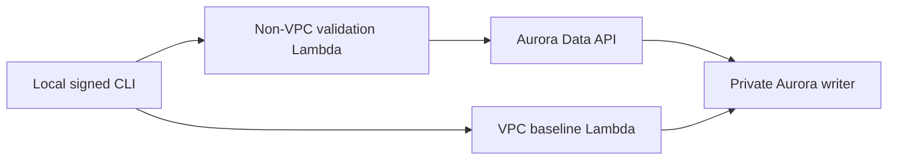

# Aurora Data API feasibility experiments

This is an isolated experiment, not a production persistence migration or an AWS
deployment of the website. The application continues to use SQLAlchemy, psycopg,
session advisory locks and LangGraph PostgresSaver. No production routes or schemas
are changed. The experiment uses fictional data and fixed 1,536-dimensional vectors;
it never constructs a live generation/embedding client.

## What is being tested

| Mechanism | Acceptance evidence |
| --- | --- |
| Checkpoints | The actual application workflow can draft, interrupt for review, revise and approve with a new saver instance; recovery after committed approval creates one response. Typed payloads larger than a Data API response round-trip in bounded chunks. Partial writes roll back; acknowledgement loss and replay are idempotent. |
| Student exclusion | Independent workers have one winner per student. Database-time expiry permits takeover with an increasing token. Old owners cannot renew, release another owner's lease, write business effects or publish checkpoints. Fencing and mutation share one short transaction. |
| Hybrid retrieval | The unchanged application search, candidate fusion, references and parent packing match a direct SQLAlchemy/psycopg baseline. Tests cover source/profile/date restrictions, deterministic ties, duplicate sources, concurrent source changes and large Unicode parent reads. |

`backend/experiments/data_api/` supplies an explicit SQL transport, experimental
checkpointer, lease implementation and a narrow **read-only retrieval adapter**. It is
not a SQLAlchemy dialect. The saver stores full typed checkpoint values rather than
deduplicating channel versions; storage efficiency and a complete asynchronous saver
interface remain outside this prototype.

Checkpoint objects and pending writes use 16 KiB binary parts, a checksum and an
atomic transaction. Pending writes retain LangGraph's task-path/index ordering.
Large parent text is read in 4,096-character pieces inside the same read snapshot.
Array inputs are JSON parameters expanded and cast in SQL. Model calls and reranking
never run inside a database transaction. Data API's transaction timeout means a
session advisory lock cannot simply be held across arbitrary model work.

Local workflow tests use a real dedicated PostgreSQL business database and a
PostgreSQL-backed **Data API protocol double** for checkpoints. This is useful recovery
evidence, but does not establish live Aurora compatibility or an all-Data-API business
repository. Live Lambda probes use the application's State type in a smaller interrupt
graph; the report names this narrower scope explicitly.

## Reproduce locally

From `backend/`, install the optional validation tools and run against the existing
dedicated test database. Follow the root README to prepare that database first.

```sh
uv sync --locked --group aws-validation
uv run --locked --group aws-validation --env-file .env.example pytest \
  tests/unit/test_data_api_sql.py tests/unit/test_data_api_runner.py \
  tests/integration/agent/test_data_api_checkpoint.py \
  tests/integration/test_data_api_validation.py
```

Without `TEST_DATABASE_URL`, integration cases are skipped, not passed. Local tests
exercise PostgreSQL semantics plus simulated AWS payload limits and failure injection;
AWS-specific engine behavior still requires the live experiment.

## Disposable AWS experiment



The runner creates a new tagged CloudFormation stack with a private Aurora PostgreSQL
17.9 writer, min/max 0–2 ACU, 300-second auto-pause, Secrets Manager credentials,
two IAM-invoked Lambda functions and a private artifact bucket. It creates no NAT,
interface endpoint, public database listener or public function URL. The baseline
Lambda uses direct psycopg against the **same Aurora fixture data**. The non-VPC
Lambda accesses it only through Data API.

Inspect the template without creating anything:

```sh
uv run --locked --group aws-validation python -m experiments.data_api template
```

Build the Linux x86-64 package separately if desired. It uses the frozen application
dependencies, excludes optional PyTorch/reranker dependencies and refuses packages
over Lambda's uncompressed size limit:

```sh
uv run --locked --group aws-validation python -m experiments.data_api package \
  --output-dir experiments/data_api/results/package-unique-name
```

Run real AWS validation, which incurs temporary AWS charges and attempts cleanup in
`finally`. The AWS profile must already be authorized; this command does not modify
the caller's permissions:

```sh
AWS_PROFILE=your-validation-profile uv run --locked --group aws-validation \
  python -m experiments.data_api live --region ap-southeast-2 \
  --engine-version 17.9 \
  --output-dir experiments/data_api/results/aws-unique-name
```

Each output directory must be new and is ignored by Git. Use `--lambda-zip` to reuse
a previously built archive. The runner compares direct-driver retrieval with Data API
using a score tolerance of `1e-6`, observes zero capacity using CloudWatch (not SQL
health probes), and measures a subsequent read-only cold resume. It records calls,
response sizes and actual engine/extension versions. `report.json` distinguishes
`passed`, `failed`, `incomplete` and `not_run`. `migration_ready` remains false: passing
three mechanisms does not migrate the rest of the application.

The caller needs CloudFormation lifecycle permissions and permission to create/delete
the template's VPC/subnets/security groups, RDS cluster/instance/subnet group,
Secrets Manager secret, Lambda functions, IAM roles/policies and PassRole, S3 bucket
and object, and CloudWatch log groups. The runner also invokes its functions, queries
Data API and reads CloudWatch metrics. Runtime IAM permissions are scoped to the
experiment's cluster and secret. Use a dedicated deployment role rather than granting
the web application these provisioning permissions.

Stack creation and deletion each have a bounded 30-minute wait; observing pause has a
15-minute window. These are operational deadlines, not an enforced billing ceiling.
If cleanup cannot finish, retain the private report's `stack_id` and delete that exact
stack after resolving its reported blocker. Do not delete similarly named existing
resources. The experiment neither discovers nor reuses an existing application DB.

## Current evidence and decision

On 2026-11-15 the first live attempt returned AWS `AccessDenied` for CloudFormation
`CreateStack`, before a stack was accepted. After an IAM update, a new stack creation
was accepted but failed during provisioning and automatically deleted. Its
`DELETE_COMPLETE` status was confirmed. Reading the failure events was separately
blocked by missing `cloudformation:DescribeStackEvents` permission, so the underlying
provisioning cause remains unknown. All three live mechanism checks are **not run**.
The runner now recognizes automatic deletion immediately, independently attempts
resource cleanup after artifact failures and recognizes already deleted stacks.
The Linux validation package was built
separately and its native dependencies imported successfully in AWS's official Linux
Python 3.12 Lambda image. The full backend run passed 1,211 tests before the final
review fixes; focused validation tests cover the final review and lifecycle fixes. Ruff lint and
format checks and the frontend production build passed. Independent review found
and verified fixes for missing transaction credentials and cleanup failure ordering.
Local test results and this AWS blocker must not be presented as a
successful Aurora migration assessment.

After live evidence is available, assess the remaining work separately: general ORM
queries and migrations, approval/source revalidation through Data API, durable task
dispatch, upload staging, policy persistence, OAuth and production observability.
In particular, the experiment's fenced sample mutation is not proof that every
existing application write has been converted to fencing.

References: [Data API access](https://docs.aws.amazon.com/AmazonRDS/latest/AuroraUserGuide/data-api.html),
[response limits](https://docs.aws.amazon.com/AmazonRDS/latest/AuroraUserGuide/data-api.limitations.html),
[transactions](https://docs.aws.amazon.com/rdsdataservice/latest/APIReference/API_BeginTransaction.html),
[automatic pause](https://docs.aws.amazon.com/AmazonRDS/latest/AuroraUserGuide/aurora-serverless-v2-auto-pause.html).
