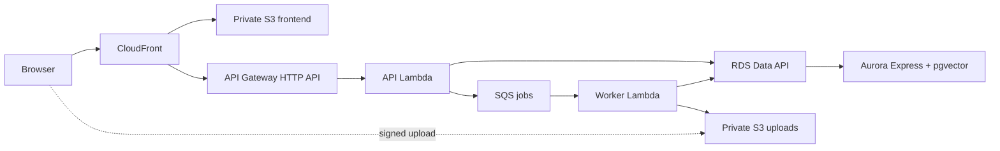

# Aurora Data API feasibility experiments

This is an isolated experiment, not a production persistence migration or an AWS
deployment of the website. The application continues to use SQLAlchemy, psycopg,
session advisory locks and LangGraph PostgresSaver. No production routes or schemas
are changed. The experiment uses fictional data and fixed 1,536-dimensional vectors;
it never constructs a live generation/embedding client.

## What is being tested

| Mechanism | Acceptance evidence |
| --- | --- |
| Checkpoints | The actual application workflow can draft, interrupt for review, revise and approve with a new saver instance; recovery after committed approval creates one response. Typed payloads larger than a Data API response round-trip in bounded chunks. Partial writes roll back; acknowledgement loss and replay are idempotent. |
| Student exclusion | Independent workers have one winner per student. Database-time expiry permits takeover with an increasing token. Old owners cannot renew, release another owner's lease, write business effects or publish checkpoints. Fencing and mutation share one short transaction. |
| Hybrid retrieval | The unchanged application search, candidate fusion, references and parent packing match a direct SQLAlchemy/psycopg baseline. Tests cover source/profile/date restrictions, deterministic ties, duplicate sources, concurrent source changes and large Unicode parent reads. |

`backend/experiments/data_api/` supplies an explicit SQL transport, experimental
checkpointer, lease implementation and a narrow **read-only retrieval adapter**. It is
not a SQLAlchemy dialect. The saver stores full typed checkpoint values rather than
deduplicating channel versions; storage efficiency and a complete asynchronous saver
interface remain outside this prototype.

Checkpoint objects and pending writes use 16 KiB binary parts, a checksum and an
atomic transaction. Pending writes retain LangGraph's task-path/index ordering.
Large parent text is read in 4,096-character pieces inside the same read snapshot.
Array inputs are JSON parameters expanded and cast in SQL. Model calls and reranking
never run inside a database transaction. Data API's transaction timeout means a
session advisory lock cannot simply be held across arbitrary model work.

Local workflow tests use a real dedicated PostgreSQL business database and a
PostgreSQL-backed **Data API protocol double** for checkpoints. This is useful recovery
evidence, but does not establish live Aurora compatibility or an all-Data-API business
repository. Live Lambda probes use the application's State type in a smaller interrupt
graph; the report names this narrower scope explicitly.

## Reproduce locally

From `backend/`, install the optional validation tools and run against the existing
dedicated test database. Follow the root README to prepare that database first.

```sh
uv sync --locked --group aws-validation
uv run --locked --group aws-validation --env-file .env.example pytest \
  tests/unit/test_data_api_*.py \
  tests/integration/agent/test_data_api_checkpoint.py \
  tests/integration/test_data_api_validation.py
```

Without `TEST_DATABASE_URL`, integration cases are skipped, not passed. Local tests
exercise PostgreSQL semantics plus simulated AWS payload limits and failure injection;
AWS-specific engine behavior still requires the live experiment.

## Terraform initialization and disposable AWS experiment

Temporary infrastructure is created and destroyed with Terraform. `infrastructure/bootstrap/` creates the
persistent `dance-studio-deployer` role and two fixed runtime roles. The approved
bootstrap trusts only the configured account's `aiengineer` user. The deployer cannot
create roles or edit IAM policies: it can only pass the two bounded runtime roles.
Network mutation requires validation Project/Purpose tags in Sydney; named databases,
functions, secrets and logs use `data-api-validation-*`. Lambda code is explicitly
denied network-interface mutations while Lambda service ENI management remains allowed.

Initialize once using the existing user's IAM role-management permissions:

```sh
terraform -chdir=infrastructure/bootstrap init
terraform -chdir=infrastructure/bootstrap plan -out=bootstrap.tfplan
terraform -chdir=infrastructure/bootstrap apply bootstrap.tfplan
```

The user must be permitted to assume `dance-studio-deployer`. These initialization
roles persist for future runs and have no provisioned compute charge. Keep bootstrap
state private and available; do not import existing shared project IAM policies.

From `backend/`, run the experiment with the existing AWS profile. Terraform's provider
assumes the deployment role automatically; temporary credentials are not committed:

```sh
uv sync --locked --group aws-validation
uv run --locked --group aws-validation python -m experiments.data_api live \
  --output-dir experiments/data_api/results/terraform-unique-name
```

The CLI builds a Linux x86-64 Lambda archive using the lockfile's pinned versions,
copies `infrastructure/express-validation/` into a private results directory, and runs
init, saved plan, apply, validation and destroy. Use `--lambda-zip` to reuse a compatible
archive. `template` prints this native Express configuration. The AWS Cloud Control
provider is used because the pinned native AWS provider does not expose Express
creation. Legacy CloudFormation helpers remain for existing regression tests only.

The Free Plan rejected standard private Aurora, so this experiment uses Aurora Express
in Sydney, with zero minimum capacity and a two-ACU maximum. Express has an IAM-authenticated
internet access gateway and no customer VPC. Both Lambda functions are non-VPC and have
no HTTP function URL. There is no NAT or private endpoint. This is an account-plan
constraint and demo choice, not a claim that Express is always preferable.

The runner grants the deployment role IAM database access to `postgres` and the baseline
role access to `baseline`, each scoped to the actual cluster Resource ID. Through verified
TLS, the initializer creates the test database, pgvector extension, fixture schema and
two limited database users. Data API uses a separate password user in Secrets Manager;
Express's master IAM user cannot authenticate to Data API. The direct psycopg baseline
uses IAM authentication and read-only fixture access. The runner enables Data API using RDS's `EnableHttpEndpoint` operation after
initialization. Cloud Control rejected an update that changed only HTTP enablement with
a create-only `WithExpressConfiguration` error; this bounded API call avoids that provider
limitation and needs no additional IAM permission. Temporary exact-cluster IAM grants are removed in
cleanup, including after a partially failed permissions apply. This requires the original
bootstrap user's IAM permissions; the assumed deployer cannot edit its own policies.

Tests use fake model data and compare retrieval with a `1e-6` score tolerance. The
runner records actual engine/extension versions, API counts, bounded response sizes,
zero-capacity metrics and subsequent cold resume. A failed apply still triggers cleanup;
an interrupted child is signaled and reaped before cleanup. The ownership-checked helper
deletes only a matching validation cluster and writer, without final snapshots, before
Terraform destroy. A destroy hook also supports manual Terraform cleanup. Both deletion
and IAM revocation are attempted independently; failures are reported explicitly. Runtime/provider timeouts are not a billing ceiling.

Terraform state contains generated database credentials. Results directories are
created with mode 0700, ignored by Git, and must remain private. If automatic cleanup
fails, run `terraform -chdir=RESULTS/terraform destroy` with the same profile;
non-secret input variables are saved in that run's private `terraform.tfvars.json`.
If the initial apply stopped before recording the destroy hook, invoke
`python -m experiments.data_api.delete_express --name EXACT_RUN_CLUSTER --role DEPLOYER_ARN`
from `backend/` first. Retain state until deletion is verified. Revoke temporary grants with
`terraform -chdir=infrastructure/bootstrap apply -var=express_cluster_resource_id=`
after reviewing a fresh plan. Bootstrap roles
are intentionally separate from temporary resources and are not destroyed by a run.

`report.json` distinguishes passed, failed, incomplete and not_run, with an in_progress
snapshot while waiting for auto-pause and cleanup. A mechanism pass
is not a full migration approval; `migration_ready` remains false.

## Current evidence and decision

On 2026-11-16, all three mechanisms **passed** in a non-VPC Lambda against Aurora
PostgreSQL 17.9 with pgvector 0.8.1. Hybrid retrieval also matched the direct SQLAlchemy/
psycopg baseline. The Lambda probe made 292 Data API calls, with an estimated maximum response of
525,884 bytes, and no model calls. Typed checkpoint restoration and lease fencing are
mechanism evidence; full application workflow recovery remains separately covered locally.

Live validation exposed `longValue` binding as PostgreSQL `bigint`. The adapter now
casts the substring position to integer. The protocol double uses psycopg `Int8`, which
reproduced the same failure before the fix and passed afterward. Data API became
queryable 63.3 seconds after enablement in the successful mechanism run; this is endpoint
activation time, not a cold-resume measurement.

The first auto-pause metric poll exposed CloudWatch's same-second start/end rejection.
The corrected query starts one minute earlier but only accepts zero-capacity datapoints
at least five minutes after the last SQL. In the final observation, a zero-ACU datapoint
was observed about 11.7 minutes after the last SQL, and Data API cold resume succeeded
in 15.2 seconds. Database connection metrics were zero during the idle observation.

Capacity was measured by a supplemental metrics-only observer on the same cluster;
the original observer was temporarily parked, then canceled into its existing cleanup.
Its raw `KeyboardInterrupt` marker records that controlled handoff. The supplementary
`extended-capacity-report.json` contains the zero datapoint and cold-resume measurement;
the primary report retains all three mechanism results and separate cleanup outcomes.
No raw result is relabeled as an uninterrupted automated pass.

The reproducible runner now allows a 30-minute observation window. AWS documents
that administrative operations can impose at least a 20-minute pause delay; this is
not evidence that such a delay caused this particular run's timing. A single idle
observation also does not establish a long-term pause or cost baseline. `migration_ready`
remains false until the application migration and acceptance stages below are complete.

Local focused validation passed 67 tests, including actual PostgreSQL recovery/retrieval
and mocked provisioning/permission failure cleanup. The full backend run passed
1,242 tests; focused tests cover subsequent lifecycle changes. The Linux package's
native dependencies imported successfully in AWS's official Python 3.12 Lambda image.
Frontend production build passed; this experiment does not alter application UI or routes.
Independent review identified transaction credential and cleanup-ordering issues, which
were fixed. Local results must not be presented as successful Aurora compatibility.

## Proposed complete demo migration

The three mechanism results support the Lambda + Aurora Data API direction. The
remaining implementation should proceed in this order, using a fresh fictional
Aurora database. Existing local data does not need to be imported. These stages are
proposed follow-up work; this PR implements the feasibility harness.



| Stage | Concrete change | Exit condition |
| --- | --- | --- |
| 1. Application persistence | Extract explicit repository/transaction interfaces from `agent/service.py`, `agent/persistence/store.py`, API CRUD/auth and document persistence. Implement Data API SQL, versioned migrations and a limited application database user. Promote the saver only after its required interfaces and retention strategy are complete. | All API/agent/document integration tests pass on the new transport. Approval, booking, response and source-revision revalidation commit in one fenced transaction; crash/retry creates one business effect. No production path requires an ORM connection or session advisory lock. |
| 2. Durable work | API records a job and returns its ID; SQS dispatches agent generation and document ingestion to a worker. Keep job status/checkpoints in Aurora, renew both queue visibility and the database lease during work, and split work into bounded steps. Use a durable outbox or equivalent dispatcher for the database-to-queue handoff. | Lost sends are recovered; duplicate delivery, worker termination and expired owners are tested. Stale workers cannot publish checkpoints or commit approvals. Failed items reach a dead-letter queue; the UI can poll and resume the same job without duplicating quota or business writes. |
| 3. Stateless API and files | Package FastAPI for Lambda, move upload staging to private S3 with bounded signed uploads, and keep model credentials in Secrets Manager. Separate API, worker and one-time initializer permissions; runtime functions receive application-user access rather than admin credentials. | No request depends on local disk or process memory. Upload validation, document revision/archival and all owner/student access boundaries retain existing behavior. Lambda packaging and failure recovery pass real AWS smoke tests. |
| 4. Website and authentication | Publish the built frontend to private S3 behind CloudFront OAC; route `/api/*` and `/auth/*` to the HTTP API without caching authenticated responses. Use one configured HTTPS origin for cookies and the exact Google OAuth callback. | Browser tests pass against the deployed origin, including a real configured Google sign-in, teacher review and source-change races. Direct S3 access is blocked; authenticated responses and cookies are handled correctly. |
| 5. Repeatable delivery | Extend Terraform to own the permanent demo stack, private remote state/locking, bounded deployment roles and a GitHub OIDC release workflow. Plan infrastructure changes, deploy code and run migrations as separate explicit steps. Keep Aurora at 0–2 ACUs initially and bound worker concurrency. | A clean checkout can reproduce the stack; a normal code release updates Lambda/frontend without replacing the database. Rollback, secret configuration, content-free logs, queue failure metrics, cold-start UX and budget alerts are verified before public release. |

SQS can deliver records more than once, so idempotent database operations remain
necessary even with partial-batch failure reporting. The sample fenced mutation in
this experiment must be applied to every real business-write boundary in stage 1.
See [AWS Lambda with SQS](https://docs.aws.amazon.com/lambda/latest/dg/with-sqs.html).

CloudFront OAC allows the frontend bucket to remain private; it does not replace
application authentication. See [S3 origin access control](https://docs.aws.amazon.com/AmazonCloudFront/latest/DeveloperGuide/private-content-restricting-access-to-s3.html)
and [HTTP API Lambda integrations](https://docs.aws.amazon.com/apigateway/latest/developerguide/http-api-develop-integrations-lambda.html).

Permanent resources, expanded deployment policies, the final domain/OAuth configuration
and public release require their own concrete Terraform plan and application changes.
The bootstrap and temporary validation resources here do not deploy that website.

References: [Aurora Express configuration](https://docs.aws.amazon.com/AmazonRDS/latest/AuroraUserGuide/CHAP_GettingStartedAurora.AuroraPostgreSQL.ExpressConfig.html),
[Data API access](https://docs.aws.amazon.com/AmazonRDS/latest/AuroraUserGuide/data-api.html),
[response limits](https://docs.aws.amazon.com/AmazonRDS/latest/AuroraUserGuide/data-api.limitations.html),
[transactions](https://docs.aws.amazon.com/rdsdataservice/latest/APIReference/API_BeginTransaction.html),
[automatic pause](https://docs.aws.amazon.com/AmazonRDS/latest/AuroraUserGuide/aurora-serverless-v2-auto-pause.html).
