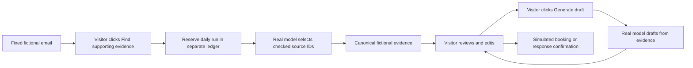

# Click-triggered public AI demo

The homepage opens `/demo/tour?mode=live`. Visitors use fixed fictional emails and sources: **Find supporting evidence** makes one real model call, then **Generate draft** makes another. Neither operation starts from navigation alone. The tour now defaults to live mode. There are no visible live/recorded mode controls. The explicit developer/test URL `/demo/tour?mode=recorded` retains the original browser-only tour without network or model calls. Makeup booking and Document enquiry are accessible tabs with arrow/Home/End keyboard navigation.

This is an isolated small-catalog demonstration, not the full owner LangGraph/RAG workflow. The first model call selects source IDs from a server-owned fictional catalog. The server requires the scenario's necessary sources and returns their canonical text; the document quote is the same immutable clothing-policy passage shown in the tour. There is no vector search or access to the owner's enabled documents, student records, policies or database. The second call generates fresh prose using only that selected evidence. The same OpenAI model configured by `OPENAI_MODEL` is used, but the public demo has its own adapter and limits.



## Access and limits

The opt-in public endpoints are `POST /api/public-demo/runs`, `/evidence` and `/draft`. They do not relax authentication on `/api/v1` or `/auth`. Each checks the exact configured `PUBLIC_BASE_URL` Origin. Guided run creation accepts only a scenario and a UUID request ID. Custom run creation additionally accepts the selected fictional student alias and an email body of 1–2,000 non-whitespace characters. The evidence endpoint accepts an empty object; the draft endpoint accepts a bounded list of teacher responses, one for each missing item, and both require an opaque run bearer token that stays in browser memory. Request bodies are limited to 12,000 bytes, including streamed bodies. Custom email text is untrusted user data inside a fixed server instruction, never a replacement prompt. Sources, tools and system instructions cannot be supplied by a visitor. Teacher responses are supplied as untrusted data to the drafting model and retained in the private run ledger for retry consistency.

One persistent SQLite ledger admits **20 runs per Melbourne calendar day** across all processes sharing that file. Starting evidence reserves a run; abandoned and failed runs still count. Repeating a run-creation request ID returns its existing token without consuming another slot. Runs expire after one hour or at the next Melbourne day, whichever comes first. Rows older than three days are removed on admission. The ledger is separate from the studio PostgreSQL database and has mode 0600; keep it in a private directory on persistent storage.

Each run allows at most two attempts for evidence and two for drafting. Attempts are reserved transactionally before the provider call and never refunded on failure, timeout, refusal or incomplete output. Completed stages return their cached result without another call. A draft attempt binds its teacher responses, and retries with different responses are rejected. A lease prevents concurrent duplicate calls; an interrupted worker can be retried after its 60-second lease. SDK retries are disabled, provider timeout is 25 seconds and each call caps output at 2,000 tokens. Inputs use a fixed server-owned catalog; custom email text is bounded to 2,000 characters. These are application request limits, not an invoice guarantee; availability remains dependent on the configured provider/model. Multiple hosts must route the public API to a single demo service using this ledger; do not create independent ledgers per replica.

Quotas, expired runs, invalid evidence, provider failures and missing configuration are visible errors, with an explicit Retry action. There is no silent substitution of prerecorded results. Browser double clicks are suppressed; retries keep the same request ID and token. Leaving, reloading or switching scenario discards local state; there is no reset button; an already-sent provider call may finish and remains counted, but its late response cannot change the new tour.

## Configuration

The service is disabled by default. Set the following privately on the server, in addition to existing `OPENAI_API_KEY`, `OPENAI_MODEL` and `PUBLIC_BASE_URL`:

```dotenv
STUDIO_PUBLIC_LIVE_DEMO=true
STUDIO_PUBLIC_DEMO_DB=/persistent/private/public-demo.sqlite3
```

The regular application includes the public router separately from staff endpoints; no application migrations or demo seeding are required. Keep API keys server-side. Owner routes and permissions are unchanged.

For a local preview that must preserve a backend from another worktree, the same router can run alone without connecting to PostgreSQL:

```sh
# backend/, with the same environment and flags above
uv run --env-file /path/to/private/.env uvicorn \
  studio_copilot.api.public_demo:create_public_demo_app --factory \
  --host 127.0.0.1 --port 8002
# frontend/, preserve the existing portal origin and backend proxy
PUBLIC_DEMO_PROXY_TARGET=http://127.0.0.1:8002 npm run dev -- \
  --host 127.0.0.1 --port 8010 --strictPort
```

`PUBLIC_DEMO_PROXY_TARGET` is optional and development-only; by default Vite forwards the public API to the usual backend on port 8000. For hosting, use the integrated application or a reverse proxy routing the public endpoints to one isolated demo service under the same public HTTPS origin.

## Review and confirmation

Live drafts remain unverified model output, with teacher review required. Public and owner drafting adapters share the first-person teacher voice. Booking drafts use the teacher’s proposed confirmation (for example, “I’ve booked Saturday…”); pending-approval and simulation notices appear outside the student email. The actual booking still remains simulated. For the document example, a teacher supplies the trial fee or chooses Confirm later before generating a complete draft. The model receives the decision alongside the evidence; the recorded example uses a deterministic template. Arbitrary final edits remain verbatim; they are not checked by AI. Booking approval and database before/after views remain simulated; no class is booked in the studio database and no email is sent.

Normal backend and browser tests use fake providers. The 2026-11-15 local smoke used both fixed scenarios through the public API with four real `gpt-6-luna` calls. Both produced evidence and drafts; the booking response used Saturday and the document response retained the teacher-fee decision. This small smoke is not a quality evaluation or production reliability claim. No real student data, owner documents, booking writes or outgoing emails were involved.

A focused follow-up booking smoke on 2026-11-15 used two additional real calls after aligning the shared teacher voice. The fresh draft confirmed Saturday in first person (“I’ve booked…”), without pending-approval language inside the student email. The external simulation/approval notices remain unchanged.


## Write a custom email

`/demo/test-email` is an interactive public form. Choose Alex Morgan or Jules Park, write a fictional email, then choose **Simulate email**. It creates a `custom` run and selects supporting evidence. The teacher answers each identified missing item, or says it will be confirmed later, before choosing Generate draft. The model classifies the message as enquiry, makeup request or teacher handoff rather than relying on a scenario choice. The result contains editable local text, source evidence and missing information; there is no booking/approval action in this free-text sandbox.

The fictional catalog is student-scoped. The latest email can revise earlier preferences. The reference date is 7 February 2027 in Melbourne. A small lexical recall backstop includes the clothing passage for clothing questions and the missing-fee notice for fee questions, so one unanswered question cannot discard a known answer to another. This is a small-catalog demo, not the full owner RAG pipeline.

Custom emails share the same twenty-run daily limit and two-attempt stage caps as the guided tour. The selected student, email, and draft-stage teacher responses are stored in the private quota ledger for idempotent retries and are removed under its three-day admission-triggered retention. Updating that ledger adds nullable context columns without resetting counts or touching the application database. A reused request ID with different input is rejected. Editing input starts a new attempt identity; unchanged retries reuse completed stages. Form inputs are disabled while submitting, and leaving discards late results.

A 2026-11-15 custom-email smoke initially found the model omitted known clothing evidence when trial cost was unknown. The partial-answer recall backstop and stronger drafting instructions address this case and have a regression test. Normal tests use fake providers; the later live check is a small diagnostic, not a general quality claim.
