# Click-triggered public AI demo

The homepage opens `/demo/tour?mode=live`. Visitors use fixed fictional emails and sources: **Find supporting evidence** makes one real model call, then **Generate draft** makes another. Neither operation starts from navigation alone. `/demo/tour` and **Use recorded demo** retain the original browser-only tour, with no network or model calls.

This is an isolated small-catalog demonstration, not the full owner LangGraph/RAG workflow. The first model call selects source IDs from a server-owned fictional catalog. The server requires the scenario's necessary sources and returns their canonical text; the document quote is the same immutable clothing-policy passage shown in the tour. There is no vector search or access to the owner's enabled documents, student records, policies or database. The second call generates fresh prose using only that selected evidence. The same OpenAI model configured by `OPENAI_MODEL` is used, but the public demo has its own adapter and limits.

```mermaid
flowchart LR
    Email[Fixed fictional email] --> Find[Visitor clicks Find supporting evidence]
    Find --> Admit[Reserve daily run in separate ledger]
    Admit --> Select[Real model selects checked source IDs]
    Select --> Evidence[Canonical fictional evidence]
    Evidence --> Generate[Visitor clicks Generate draft]
    Generate --> Model[Real model drafts from evidence]
    Model --> Review[Visitor reviews and edits]
    Review --> Confirmation[Simulated booking or response confirmation]
```



## Access and limits

The opt-in public endpoints are `POST /api/public-demo/runs`, `/evidence` and `/draft`. They do not relax authentication on `/api/v1` or `/auth`. Each checks the exact configured `PUBLIC_BASE_URL` Origin. Run creation accepts only a scenario and a UUID request ID. The stage endpoints accept only an empty object and an opaque run bearer token, which stays in browser memory. Request bodies are limited to 1 KiB, including streamed bodies. There is no arbitrary prompt, email, document, tool or teacher-answer submission to the model.

One persistent SQLite ledger admits **10 runs per Melbourne calendar day** across all processes sharing that file. Starting evidence reserves a run; abandoned and failed runs still count. Repeating a run-creation request ID returns its existing token without consuming another slot. Runs expire after one hour or at the next Melbourne day, whichever comes first. Rows older than three days are removed on admission. The ledger is separate from the studio PostgreSQL database and has mode 0600; keep it in a private directory on persistent storage.

Each run allows at most two attempts for evidence and two for drafting. Attempts are reserved transactionally before the provider call and never refunded on failure, timeout, refusal or incomplete output. Completed stages return their cached result without another call. A lease prevents concurrent duplicate calls; an interrupted worker can be retried after its 60-second lease. SDK retries are disabled, provider timeout is 25 seconds and each call caps output at 2,000 tokens. Inputs are fixed and bounded. These are application request limits, not an invoice guarantee; availability remains dependent on the configured provider/model. Multiple hosts must route the public API to a single demo service using this ledger; do not create independent ledgers per replica.

Quotas, expired runs, invalid evidence, provider failures and missing configuration are visible errors, with an explicit Retry action and a recorded-demo link. There is no silent substitution of prerecorded results. Browser double clicks are suppressed; retries keep the same request ID and token. Reset, leaving or switching scenario discards local state; an already-sent provider call may finish and remains counted, but its late response cannot change the new tour.

## Configuration

The service is disabled by default. Set the following privately on the server, in addition to existing `OPENAI_API_KEY`, `OPENAI_MODEL` and `PUBLIC_BASE_URL`:

```dotenv
STUDIO_PUBLIC_LIVE_DEMO=true
STUDIO_PUBLIC_DEMO_DB=/persistent/private/public-demo.sqlite3
```

The regular application includes the public router separately from staff endpoints; no application migrations or demo seeding are required. Keep API keys server-side. Owner routes and permissions are unchanged.

For a local preview that must preserve a backend from another worktree, the same router can run alone without connecting to PostgreSQL:

```sh
# backend/, with the same environment and flags above
uv run --env-file /path/to/private/.env uvicorn \
  studio_copilot.api.public_demo:create_public_demo_app --factory \
  --host 127.0.0.1 --port 8002
# frontend/, preserve the existing portal origin and backend proxy
PUBLIC_DEMO_PROXY_TARGET=http://127.0.0.1:8002 npm run dev -- \
  --host 127.0.0.1 --port 8010 --strictPort
```

`PUBLIC_DEMO_PROXY_TARGET` is optional and development-only; by default Vite forwards the public API to the usual backend on port 8000. For hosting, use the integrated application or a reverse proxy routing the public endpoints to one isolated demo service under the same public HTTPS origin.

## Review and confirmation

Live drafts remain unverified model output, with teacher review required. Document drafts always retain an unresolved trial-fee marker. A teacher supplies a fact or chooses Confirm later, then Update draft inserts that decision into the generated draft locally. This is deterministic, makes no extra model call, and replaces direct response edits. Arbitrary final edits remain verbatim; they are not checked by AI. Booking approval and database before/after views remain simulated; no class is booked in the studio database and no email is sent.

Normal backend and browser tests use fake providers. The 2026-11-15 local smoke used both fixed scenarios through the public API with four real `gpt-6-luna` calls. Both produced evidence and drafts; the booking response kept Saturday pending approval and the document response retained the teacher-fee decision. This small smoke is not a quality evaluation or production reliability claim. No real student data, owner documents, booking writes or outgoing emails were involved.
