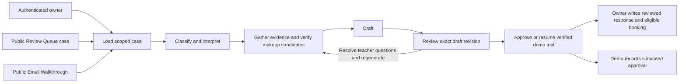

# Public interactive demos

The public Review Queue and Email Walkthrough run the same LangGraph as the owner workspace. Review Queue visitors choose a published fictional case. Email Walkthrough visitors pick a fictional sender or start as a new enquirer, write an email, and can add a follow-up after approving the reply. The graph reads the published Database and Timetable records and the fictional Studio Knowledge documents. Selecting a case loads its example email. The first evidence request starts a live AI run.



At the entry to the shared draft node, the demo pauses so visitors can see the evidence and answer any unresolved questions. If drafting identifies another fact that needs a teacher decision, the demo asks for that answer and resumes the shared graph's revision path. Makeup verification checks the enrolled absence, the original notice, attended level, current session roster, conflicting sessions and existing bookings. The public example records use a fixed reference date. A verified makeup must resolve to one exact session before the graph can produce a booking proposal.

## Public API

- `GET /api/public-demo/cases/{scenario}` returns the public email messages for one of `booking`, `document`, `noah` or `riley`.
- `POST /api/public-demo/runs` accepts a case ID and a UUID request ID. It returns an opaque bearer token scoped to the run.
- `POST /api/public-demo/walkthrough/runs` accepts a UUID request ID, a fictional student ID or `new`, and up to 2,000 characters of fictional email text. An optional prior run token links an approved reply to the next email from the same sender. Each email uses the shared run allowance.
- `POST /api/public-demo/evidence` runs the graph to the draft pause. For a verified automatic trial in Email Walkthrough with no additional questions to answer, it also resumes the shared review and approval steps and returns an `automatic_approval`. `POST /api/public-demo/draft` resumes it with up to 20 ordered teacher answers or explicit deferrals and returns the draft revision. `POST /api/public-demo/revise` applies answers to teacher questions surfaced during drafting and returns the updated draft revision.
- `POST /api/public-demo/approve` requires the reviewed revision. A proposed booking must keep its verified confirmation wording. The result can include a before-and-after roster preview built from fictional data. The underlying roster is read-only.

The live POST endpoints require the exact configured website origin. Runs expire after one hour or at the end of the Melbourne day. Hosted demos share a 20-run daily cap. Loopback previews are unlimited. Retries keep the same run identity and teacher decisions. The SQLite ledger holds both stage state and LangGraph checkpoints and removes expired records. It must be private and shared by workers running the demo. The owner database and Postgres checkpointer are unchanged.

Open **Email walkthrough** at `/demo/test-email`. The browser can recover the current turn in the same tab until the conversation expires. Makeup approval can simulate a verified booking. A clear trial booking request can complete automatically for one eligible fictional session with room. A short acceptance uses the previous approved reply only when it offered one verified trial. A trial confirmation is recorded in SQLite and leaves the published roster intact. Trial booking in the owner workspace still goes to teacher review. The old guided tour route at `/demo/tour` redirects to the Review Queue. The owner's authenticated **Test email** remains the workspace intake entry point.

## Configuration

Set the following privately on the server with `OPENAI_API_KEY`, `OPENAI_MODEL` and `PUBLIC_BASE_URL`:

```dotenv
STUDIO_PUBLIC_LIVE_DEMO=true
STUDIO_PUBLIC_DEMO_DB=/persistent/private/public-demo.sqlite3
```

For a standalone local API preview, run `studio_copilot.api.public_demo:create_public_demo_app` with Uvicorn's `--factory` flag and set `PUBLIC_DEMO_PROXY_TARGET` for Vite. No workspace database is needed for that preview. The regular application serves both endpoints and the built frontend.
