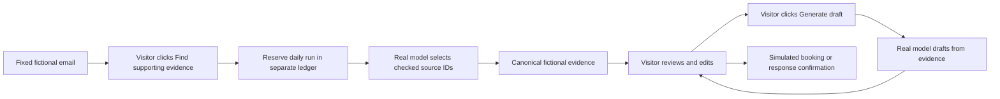

# Click-triggered public AI demo

The homepage opens `/demo/tour?mode=live`. Visitors use fixed fictional emails and sources: **Find supporting evidence** makes one real model call, then **Generate draft** makes another. Neither operation starts from navigation alone. The tour now defaults to live mode. There are no visible live/recorded mode controls. The explicit developer/test URL `/demo/tour?mode=recorded` retains the original browser-only tour without network or model calls. Makeup booking and Document enquiry are accessible tabs with arrow/Home/End keyboard navigation.

This is an isolated small-catalog demonstration, not the full owner LangGraph/RAG workflow. The first model call selects source IDs from a server-owned fictional catalog. The server requires the scenario's necessary sources and returns their canonical text; the document quote is the same immutable clothing-policy passage shown in the tour. There is no vector search or access to the owner's enabled documents, student records, policies or database. The second call generates fresh prose using only that selected evidence. The same OpenAI model configured by `OPENAI_MODEL` is used, but the public demo has its own adapter and limits.



The public Studio Knowledge document library reads the same fictional document catalog used by the live demo. It includes first-class, clothing, makeup, class and fee guidance. The library is read-only and is served by `/api/public-demo/documents`, including when live model calls are disabled. The walkthrough uses a fixed catalog rather than the owner document retrieval pipeline.

## Public review queue

`/demo/reviews` presents four fictional enquiries in a teacher-facing email queue. Alex and Jules use the two guided scenarios; Noah and Riley use the custom-email pipeline with their fictional student context. The visitor opens an enquiry and chooses **Generate draft**; the interface starts a run, retrieves the selected fictional evidence, and generates a response. For the document enquiry, it pauses for the teacher to supply or defer the missing trial fee before drafting. For Noah and Riley, any missing information returned by the model is presented for teacher responses before drafting. The editable response, evidence and decisions are temporary, and leaving or refreshing discards them. Approval is simulated and never sends email or changes studio records. For the booking scenario, the confirmation card shows the fixed example session; changing the response text does not change that session.

Evidence cards show short descriptions and the exact fictional catalog text sent to the drafting model. The email example links to the displayed fictional messages, and the clothing example can show the fictional policy text and revision. Other catalog facts are synthetic demo inputs, not citations to underlying studio records. The public queue shares the existing daily run allowance and stage limits with the guided tour and email walkthrough. Historical predefined student and review records remain accessible from their existing links.

## Access and limits

The opt-in public endpoints are `POST /api/public-demo/runs`, `/evidence` and `/draft`. They do not relax authentication on `/api/v1` or `/auth`. Each checks the exact configured `PUBLIC_BASE_URL` Origin. Guided run creation accepts only a scenario and a UUID request ID. Custom run creation additionally accepts a new enquirer or selected fictional student identifier and an email body of 1–2,000 non-whitespace characters. The evidence endpoint accepts an empty object; the draft endpoint accepts a bounded list of teacher responses, one for each missing item, and both require an opaque run bearer token that stays in browser memory. Request bodies are limited to 120,000 bytes, including streamed bodies. Custom email text and fictional conversation memory are untrusted data inside a fixed server instruction, never a replacement prompt. The selected student’s displayed conversation and request summaries accompany both evidence selection and draft generation. Sources, tools and system instructions cannot be supplied by a visitor. Teacher responses are supplied as untrusted data to the drafting model and retained in the private run ledger for retry consistency.

One persistent SQLite ledger admits **20 runs per Melbourne calendar day** across all processes sharing that file. Starting evidence reserves a run; abandoned and failed runs still count. Repeating a run-creation request ID returns its existing token without consuming another slot. Runs expire after one hour or at the next Melbourne day, whichever comes first. Rows older than three days are removed on admission. The ledger is separate from the studio PostgreSQL database and has mode 0600; keep it in a private directory on persistent storage.

Each run allows at most two attempts for evidence and two for drafting. Attempts are reserved transactionally before the provider call and never refunded on failure, timeout, refusal or incomplete output. Completed stages return their cached result without another call. A draft attempt binds its teacher responses, and retries with different responses are rejected. A lease prevents concurrent duplicate calls; an interrupted worker can be retried after its 60-second lease. SDK retries are disabled, provider timeout is 25 seconds and each call caps output at 2,000 tokens. Inputs use a fixed server-owned catalog; custom email text is bounded to 2,000 characters. These are application request limits, not an invoice guarantee; availability remains dependent on the configured provider/model. Multiple hosts must route the public API to a single demo service using this ledger; do not create independent ledgers per replica.

Quotas, expired runs, invalid evidence, provider failures and missing configuration are visible errors, with an explicit Retry action. There is no silent substitution of prerecorded results. Browser double clicks are suppressed; retries keep the same request ID and token. Leaving, reloading or switching scenario discards local state in the guided tour. The email walkthrough restores a still-valid thread and provides a reset button. An already-sent provider call may finish and remains counted.

## Configuration

The service is disabled by default. Set the following privately on the server, in addition to existing `OPENAI_API_KEY`, `OPENAI_MODEL` and `PUBLIC_BASE_URL`:

```dotenv
STUDIO_PUBLIC_LIVE_DEMO=true
STUDIO_PUBLIC_DEMO_DB=/persistent/private/public-demo.sqlite3
```

The regular application includes the public router separately from staff endpoints; no application migrations or demo seeding are required. Keep API keys server-side. Owner routes and permissions are unchanged.

Local previews configured with a loopback `PUBLIC_BASE_URL` have no daily run cap. For a local preview that must preserve a backend from another worktree, the same router can run alone without connecting to PostgreSQL:

```sh
# backend/, with the same environment and flags above
uv run --env-file /path/to/private/.env uvicorn \
  studio_copilot.api.public_demo:create_public_demo_app --factory \
  --host 127.0.0.1 --port 8002
# frontend/, preserve the existing portal origin and backend proxy
PUBLIC_DEMO_PROXY_TARGET=http://127.0.0.1:8002 npm run dev -- \
  --host 127.0.0.1 --port 8010 --strictPort
```

`PUBLIC_DEMO_PROXY_TARGET` is optional and development-only; by default Vite forwards the public API to the usual backend on port 8000. For hosting, use the integrated application or a reverse proxy routing the public endpoints to one isolated demo service under the same public HTTPS origin.

## Review and confirmation

Live drafts remain unverified model output, with teacher review required. Public and owner drafting adapters share the first-person teacher voice. Booking drafts use the teacher’s proposed confirmation (for example, “I’ve booked Saturday…”); pending-approval and simulation notices appear outside the student email. The actual booking still remains simulated. For the document example, a teacher supplies the trial fee or chooses Confirm later before generating a complete draft. The model receives the decision alongside the evidence; the recorded example uses a deterministic template. Arbitrary final edits remain verbatim; they are not checked by AI. Booking approval and database before/after views remain simulated; no class is booked in the studio database and no email is sent.

Normal backend and browser tests use fake providers. The 2026-11-15 local smoke used both fixed scenarios through the public API with four real `gpt-6-luna` calls. Both produced evidence and drafts; the booking response used Saturday and the document response retained the teacher-fee decision. This small smoke is not a quality evaluation or production reliability claim. No real student data, owner documents, booking writes or outgoing emails were involved.

A focused follow-up booking smoke on 2026-11-15 used two additional real calls after aligning the shared teacher voice. The fresh draft confirmed Saturday in first person (“I’ve booked…”), without pending-approval language inside the student email. The external simulation/approval notices remain unchanged.


## Write a custom email

`/demo/test-email` supports sequential fictional emails in a conversation. Each email consumes one run from the shared daily allowance, and retries use the same request identity. The visitor reviews and accepts an editable, unsent draft before the next email. The accepted reply and preceding customer emails provide context for the next turn; common reply-chain delimiters are stripped from model input. The visitor can reset the conversation, and the browser restores its opaque thread token after refresh while the thread remains valid. Threads expire after one hour or the next Melbourne day and are limited to ten emails. Private ledger rows are removed after three days during subsequent admission or thread creation.

Trial enquiries track experience, preferred day, an evidence-backed class option, missing details and next action. The fictional catalog only lists a Level 2 Saturday class; suitability and availability require teacher confirmation. Unsupported placements are escalated. The visitor confirms whether the accepted reply actually offers that option before an affirmative customer reply is treated as a request. A named mock proposal can then be approved in the walkthrough. Approval is simulated, revision-checked and idempotent. No email, staff task or booking is created. The source remains the isolated fictional catalog, not the owner RAG pipeline. Teacher-supplied policy answers and customer-supplied details remain separate.

The thread endpoints under `/api/public-demo/threads` use the same origin, rate, stage retry, and evidence validation boundaries as existing runs. Each thread is accessed with an opaque bearer token. Keep the ledger private: it contains fictional emails, accepted replies, workflow state and teacher responses for retry and restoration.

A 2026-11-15 custom-email smoke initially found the model omitted known clothing evidence when trial cost was unknown. The partial-answer recall backstop and stronger drafting instructions address this case and have a regression test. Normal tests use fake providers; the later live check is a small diagnostic, not a general quality claim.
