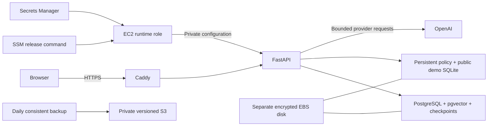

# EC2 demo deployment

The complete application runs on one Sydney EC2 instance: Caddy terminates HTTPS,
FastAPI serves the compiled frontend and authenticated API, and PostgreSQL/pgvector
stores studio records, document revisions and LangGraph checkpoints. This keeps the
existing SQLAlchemy/psycopg repositories and student advisory locks. No Lambda/Data API
persistence migration is required. The isolated experiments in document 22 remain
feasibility evidence, not the deployed application's database implementation.



## Capacity and account plan

The default is the Free Plan-compatible x86 `t3.small` (2 GiB, two vCPUs), with a
2 GiB swap file, one API worker and bounded container memory. Linux inference uses
CPU-only PyTorch. The build validates a real L6 CPU prediction and prepares both
currently supported reranker caches without making model API calls. Verify runtime
memory on the deployed instance before increasing traffic. Burst credits use Standard
mode so sustained CPU is throttled instead of incurring Unlimited surplus charges.

The stack has a 40 GiB encrypted root disk, a separate 20 GiB encrypted data disk,
one Elastic IPv4 address, a Secrets Manager secret, private S3 storage and an EC2
status alarm. There is no NAT gateway, load balancer or managed database. EC2 compute,
EBS, IPv4, Secrets Manager, S3 and provider usage are separate charges. Free Plan
credits are temporary and shared with the account's other projects; they are not a
permanent free hosting entitlement. Deployment does not upgrade the account.

Only ports 80/443 are public. Port 80 supports ACME and HTTPS redirects; SSH and
PostgreSQL are not exposed. Administration uses SSM. IMDSv2 is required with hop
limit 1; application containers do not need the EC2 runtime role's AWS credentials.
The initial hostname is `studio.<elastic-ip-with-dashes>.sslip.io`, using the public
sslip.io DNS service and Caddy's managed TLS certificate. It can later be replaced
with an owned domain. DNS/certificate issuance and Google callback registration must
be checked on the live deployment; configuration alone is not a successful login.

## Initialize Terraform

Use the existing AWS profile and `aiengineer` bootstrap identity. The new bootstrap
adds project-scoped EC2 deployment policies to the existing `dance-studio-deployer`
role; it does not grant that role IAM policy editing. A distinct runtime role has
SSM node access, read access to this application's secret and release artifacts,
and write access to this application's backup prefix.

```sh
terraform -chdir=infrastructure/ec2-bootstrap init
terraform -chdir=infrastructure/ec2-bootstrap plan -out=bootstrap.tfplan
terraform -chdir=infrastructure/ec2-bootstrap apply bootstrap.tfplan
terraform -chdir=infrastructure/ec2-bootstrap output -json backend \
  > infrastructure/ec2-demo/backend.json
```

The first-ever bootstrap creates the state bucket using private local state. Then
connect that bootstrap itself to S3 (the generated backend file is ignored):

```sh
cat > infrastructure/ec2-bootstrap/backend.tf <<'BACKEND'
terraform {
  backend "s3" {}
}
BACKEND
terraform -chdir=infrastructure/ec2-bootstrap init -migrate-state -force-copy \
  -backend-config=bucket=dance-studio-ec2-state-YOUR_ACCOUNT_ID \
  -backend-config=key=bootstrap/terraform.tfstate \
  -backend-config=region=ap-southeast-2 -backend-config=encrypt=true \
  -backend-config=use_lockfile=true
```

For an **existing** deployment in a fresh checkout, create that backend file and use
`init -reconfigure` with those options **before** planning/applying bootstrap; connect
to the existing remote state rather than creating duplicate IAM resources from empty
local state. Do not force-copy stale local state over an existing remote deployment.
Bootstrap uses the original profile; the application's separate backend assumes the
deployer role. Both use private versioned S3 state and native Terraform locking. The backend and generated input
files are ignored. Before applying, obtain the official Ubuntu 24.04 amd64 AMI from
`/aws/service/canonical/ubuntu/server/24.04/stable/current/amd64/hvm/ebs-gp3/ami-id`
and select an available Sydney AZ; save `account_id`, `ami_id`, `availability_zone`
and `instance_type` in ignored `infrastructure/ec2-demo/terraform.tfvars.json`.
Pin the AMI input; normal code releases must not replace the host. Cloud-init user data
is initial provisioning only and is ignored on later infrastructure plans; reviewed
release archives update host helpers explicitly. To change the public hostname, set
the Terraform `domain` input, plan/apply, register the new Google callback, then run
`configure` and `release` again. The desired HTTPS origin is stored with application
configuration; neither the database nor session secret is regenerated.

```sh
terraform -chdir=infrastructure/ec2-demo init -backend-config=backend.json
terraform -chdir=infrastructure/ec2-demo plan -out=application.tfplan
terraform -chdir=infrastructure/ec2-demo apply application.tfplan
```

The data disk, instance, application secret and buckets have destruction protection.
EC2 termination protection adds a second guard. Replacing a failed host requires an
explicit recovery plan in the same AZ for reattachment, or an off-host backup restore
for a new AZ. Disk retention is not automatic instance failover. Do not remove these
protections or run destructive Docker volume cleanup as a release step.

## Configure and release

From the root, use the default backend development environment (which includes
boto3), or run these commands with `backend/.venv/bin/python`. Configuration copies
only the named provider/Google/owner settings from the specified private dotenv file;
it does not copy the local database URL, local admin token or local filesystem paths.
New database, admin and session secrets are generated once and preserved on subsequent
updates. A database password change is rejected on the host until explicit SQL password
rotation is performed. Existing optional provider settings are retained.

```sh
backend/.venv/bin/python deployment/ec2/deploy.py configure --env-file /private/path/backend.env
# Add the printed exact HTTPS callback to Google's OAuth Authorized redirect URIs.
backend/.venv/bin/python deployment/ec2/deploy.py release
backend/.venv/bin/python deployment/ec2/deploy.py smoke
```

Secrets Manager receives credentials directly through the SDK. Plaintext secret
values never enter Terraform, user data, the source archive, SSM command arguments
or normal deployment output. The host writes mode-0600 configuration atomically on
the encrypted data disk; Docker reads it when creating the application container.

Releases require a clean committed checkout. The CLI archives that commit, uploads
it to the private release prefix and sends only its commit and SHA-256 identities
through SSM. The host validates the archive, updates versioned host helpers, builds
an immutable application image and preserves current/previous images. Redeploying the
same commit for configuration or hostname changes keeps the last distinct release
and its image as the rollback target. A shared host
lock excludes overlapping releases and backups. Build failures leave the previous
application running. Application/database changes after the backup boundary have a
maintenance window; failed migrations or readiness checks stop the candidate. The
script records failed/ready status and does not claim a successful rollback.

Application migrations, schema parity checks and LangGraph checkpoint provisioning
are separate explicit release steps. Each release also migrates the separate
`studio_copilot_public` database and prepares its fictional document index before
restarting the app. New embeddings can incur provider charges. The index is
reproducible and excluded from the owner database backup; prepare it again after
restoring. Fictional fixtures are inserted only on the
first application setup; subsequent releases preserve teacher edits. The writable
policy **directory**, public demo ledger and PostgreSQL data live on the separate
data disk. Container recreation does not reset daily demo allowances or policy edits.
Caddy certificates are persistent on that disk as well. The PostgreSQL bind-mount
parent is owned by the pinned image's postgres UID/GID, with mode 0700; release
checks traversal/write access as that user before database startup.

## Backups and recovery verification

The host's `studio-backup.timer` runs daily around 04:00 Australia/Sydney. Backups
briefly stop the application, dump the whole database including checkpoints, copy the
policy and use SQLite's backup API for the quota ledger. A SHA-256 manifest covers the
dump and data files. Backups are uploaded with server-side encryption to private,
versioned S3. Local backups are retained for seven days after successful upload;
S3's current backup retention is 30 days. A failed upload reports failure and does
not delete the existing backups. Monitor the systemd service; the status alarm alone
does not detect a failed backup or an application error.

For an independent restore check on the host, run `studio-backup`, then invoke:

```sh
sudo studio-verify-restore /srv/studio/backups/EXACT_BACKUP.tar.gz
```

This validates checksums and SQLite integrity, starts a randomly named disposable
PostgreSQL container with no network or published ports, restores the dump and checks
schema/vector/record/checkpoint counts. It deletes only that container and its anonymous
data volume. It never writes to the running application's database. A first deployment
still requires this real check; unit tests alone do not prove database restoration.

For actual disaster recovery, select and download a known successful S3 backup using
the deployer, verify it, stop the application and restore to a newly initialized data
disk/database. Restore policy and SQLite ownership to UID/GID 10001 and use the same
private database/session secret. Use the recorded release with its matching schema.
Do not automatically downgrade the database: existing migrations deliberately refuse
some destructive downgrades. Restoring an older quota ledger also restores its older
allowance history and needs an explicit operator decision.

OS security updates run automatically without automatic reboot. Reboot after checking
for active work, then verify data, HTTPS and application health. This is a single-host
Demo deployment, with a daily-backup recovery point and a manual host-recovery process.

## Acceptance

Before reporting the full deployment complete, verify HTTPS/hashed frontend assets,
anonymous rejection on staff routes, exact-origin checks, configured and successful
Google owner sign-in, persisted owner/document/checkpoint/policy/quota state across
container recreation and reboot, real CPU reranking under the memory limit, an isolated
backup restore, and a bounded live fictional AI request. Do not present a configured
Google client, a healthy `/health` response or a successful image build as all of these
checks. Provider calls, browser approval steps and any remaining blockers must be
reported explicitly.
